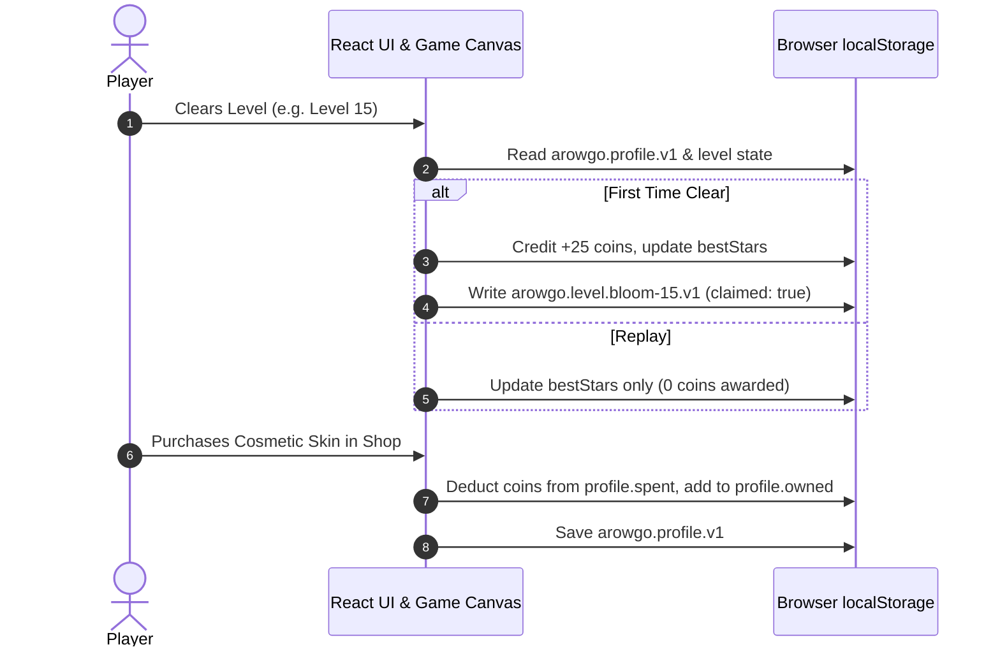

# Account and currency flow diagrams

Current architecture and balance ownership contracts. Reconciled 20 November 2026. [Account services](ACCOUNT-SERVICES.md) · [Server economy](SERVER-ECONOMY.md) · [Cloud recovery guide](CLOUD-SAVE-RECOVERY.md).

## 1. Balance ownership matrix

There are three distinct storage and currency operating models in AROWGO. Currency balances are never merged between them.

| Mode | Coin & Gem Authority | Inventory Ownership | Level Progress Authority | Network Dependency |
| --- | --- | --- | --- | --- |
| **Local Guest Play** | Device `localStorage` | Device `localStorage` | Device `localStorage` | **None** (100% offline) |
| **PlayFab Cloud Snapshots** (Dev) | Device `localStorage` (Cloud stores backup copy) | Device `localStorage` (Cloud stores backup copy) | Device `localStorage` (Cloud stores backup copy) | PlayFab Entity API on save/restore |
| **Reviewed Account Wallet** (Dev) | **Server SQLite Ledger** (`economy.sqlite`) | **Server SQLite Ledger** (`economy.sqlite`) | Server records clears; local caches session state | Server verification on clear/purchase |

---

## 2. Flow 1: Local offline play (Guest)

In standard gameplay (including the live Vercel production deployment), the client device is the sole authority.



- **Coins earned**: 25 coins per level on first clear; 0 on repeat clears.
- **Spent coins**: Tracked in `profile.spent`; net available coins $= \sum \text{earned} - \text{spent}$.
- **Gems**: Granted via welcome gift (`gemGiftClaimed`) or chest rewards.

---

## 3. Flow 2: Legacy PlayFab snapshot sync (Development)

Used for device backup in development. Snapshots are unverified raw local storage archives.

```mermaid
sequenceDiagram
    autonumber
    actor Player
    participant Client as Web Client (localhost:4173)
    participant Server as Dev Account Server (127.0.0.1:4174)
    participant PlayFab as PlayFab Entity API (116A87)

    Note over Client,PlayFab: Automatic Save Flow on Level Completion
    Client->>Client: Story level completed & written to localStorage
    Client->>Server: POST /api/arowgo/v1/account/cloud (action: "save", operationId, snapshot)
    Server->>Server: Validate entries <= 500, raw size <= 512 KiB
    Server->>Server: Pack gzip/brotli (check <= 10,700 bytes cap)
    Server->>PlayFab: SetObjects (arowgo-save-v1, arowgo-save-overflow-v1) with ExpectedProfileVersion
    alt Version Matches
        PlayFab-->>Server: HTTP 200 (Updated ProfileVersion)
        Server-->>Client: HTTP 200 (Save confirmed)
        Client->>Client: Clear pending operationId in sync anchor
    else Concurrency Mismatch (save-conflict)
        PlayFab-->>Server: EntityProfileVersionMismatch
        Server-->>Client: HTTP 409 save-conflict
        Client->>Client: Pause auto-sync; notify user to resolve conflict
    end
```

---

## 4. Flow 3: Server-wallet migration and second-device restore

In the reviewed account-wallet preview (`SERVER-ECONOMY.md`), server SQLite ledger takes over balance authority.

```mermaid
sequenceDiagram
    autonumber
    actor Player
    participant Device1 as First Device
    participant Server as Account & Wallet Server
    participant DB as SQLite Ledger (economy.sqlite)
    participant Device2 as Second Device

    Note over Device1,Server: Step 1: Reviewed Migration from Device 1
    Player->>Device1: Review Local Save for Server Binding
    Device1->>Server: POST /api/arowgo/v1/economy/review (local backup JSON)
    Server->>Server: Validate backup, compute SHA-256 backupHash
    Server-->>Device1: Return review receipt & backupHash
    Device1->>Server: POST /api/arowgo/v1/economy/migrate (commit binding)
    Server->>DB: Open wallet transaction
    Server->>DB: Insert initial balances, clear receipts & claimed skins
    Server->>DB: Record account binding
    DB-->>Server: Commit successful
    Server-->>Device1: Migration complete
    Device1->>Device1: Set binding key arowgo.economy.binding.v1

    Note over Server,Device2: Step 2: Clean Restore on Second Device
    Player->>Device2: Sign in with Google on Second Device
    Device2->>Server: GET /api/arowgo/v1/economy/account-progress
    Server->>DB: Query cleared levels, bestStars, wallet, equipped skin
    DB-->>Server: Return verified account state
    Server-->>Device2: Progress manifest (cleared IDs, stars, wallet balances)
    Device2->>Device2: Validate with accountRestorePlan()
    Device2->>Device2: Create recovery journal in localStorage
    Device2->>Device2: Write namespaced keys: arowgo.economy.<accountId>.save.*
    Device2->>Device2: Set device binding; remove restore journal
    Note over Device2: Second device now shares wallet and cleared levels!
```

### Key isolation rules

1. **Unlinked device saves are untouched**: When an account is bound on Device 2, the local unlinked saves (`arowgo.profile.v1`) remain intact in storage.
2. **Appearance remains device-local**: Selected avatar portraits and frames remain stored locally on each device.
3. **No double claiming**: First-clear coin rewards exist in the server ledger. Replaying a completed level on Device 2 cannot award duplicate first-clear coins.
