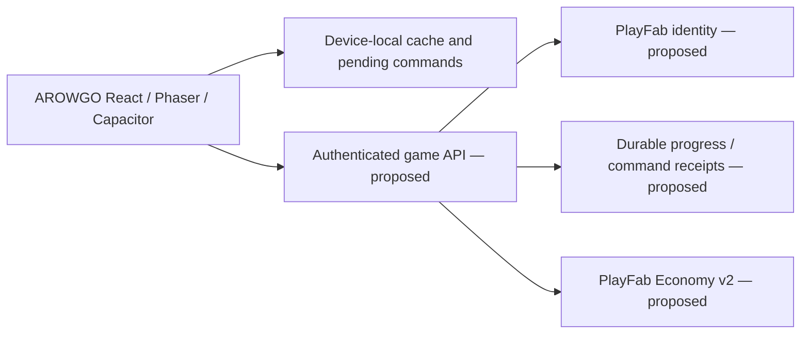

> Status reconciled 20 November 2026: this file preserves rollout/design history. Earlier counts, pending gates and UI descriptions below are dated snapshots. Use [current implementation](ACCOUNT-SERVICES.md) for present behavior; this history is not a current setup checklist.

# AROWGO account and backend plan

> Current web implementation now uses verified Google ID tokens and PlayFab OpenID Connect. The earlier authorization-code contract below is superseded for web. See [refactor and required setup](ACCOUNT-BACKEND-DEV.md).

> 18 November update: an isolated development Google backend and test page are implemented. [Current provider-spike status](ACCOUNT-BACKEND-DEV.md) supersedes earlier statements that no service code exists. Live provider success and production service gates remain open.

Status: B01 started on 16 November 2026: isolated contracts, a disabled web transport and read-only legacy capture are implemented. See [implementation status](ACCOUNT-FOUNDATION.md). The service architecture below remains proposed. No PlayFab title, account service, provider integration, cloud sync, billing or server economy is implemented or provisioned. This is the next development priority, ahead of Frostfall Peaks. The supplied generic Android/Kotlin document is reference material, not executable implementation authority.

## Scope and existing foundation

Retain React 19, TypeScript, Phaser 4, Vite and Capacitor 8. The browser and Android wrapper share the TypeScript game. Native provider SDKs belong behind Capacitor adapters; do not rewrite AROWGO in Kotlin or copy the unrelated racing/Pygame examples. Package versions are in package.json; runtime rules are pure TypeScript and can be reused by a trusted service.

First delivery: local guest play, protected online guest provisioning, Google sign-in/linking, session lifecycle, account recovery, cloud backup/restore, explicit conflict handling, and a protected economy boundary. Add other providers, rankings and social features later. PGS is a separate optional Android integration. Multiplayer and Photon are outside this milestone.

## Proposed architecture

AROWGO web/Capacitor client → authenticated game API → PlayFab identity and Economy v2, plus a durable operation/progress ledger. A TypeScript backend can reuse the versioned rules and canonical level definitions. Azure Functions is a deployment candidate, not a configured service; hosting, transactional database, region and costs remain implementation decisions.

The API owns the trusted mapping from the authenticated subject to the AROWGO account. Never accept a player ID in a request body as proof of ownership. Track the PlayFab player and entity identifiers explicitly; do not confuse them. Keep future InterFrozt games namespaced with separate game entitlements/progress. Studio-wide identity is a later design decision, not a reason to combine all wallets into one title now.

| Boundary         | Responsibility                                                                      |
| ---------------- | ----------------------------------------------------------------------------------- |
| Local game       | Rendering, input, offline attempts, preferences, pending sync queue                 |
| Auth adapter     | Web/native provider credential acquisition, secure session transport, renew/logout  |
| Game API         | Account mapping, validated commands, rate limits, replay checks, conflict policy    |
| PlayFab identity | Linked provider identities and player authentication                                |
| Economy v2       | Authoritative inventory/currency operations and marketplace redemption when enabled |
| Durable ledger   | First-clear claims, import receipts, command outcomes, reconciliation and revisions |

Do not claim a profile-data write and an inventory transaction are one atomic operation. Use recoverable command states and an outbox/reconciliation process across service boundaries. Keep a single authoritative wallet, not independently editable copies in two databases.

## Proposed trust boundaries

The client submits commands; the trusted layer decides rewards and returns committed state. This diagram is the target design, not a deployed system.

## Authentication and linking

1. Let an offline guest start without a network dependency. Local guest identity is not yet a cloud account.
2. When online/account features are requested, provision the online guest through the trusted service with abuse controls. A client-chosen Custom ID must not become an unauthenticated account takeover credential.
3. Google sign-in obtains the correct credential through a platform-specific adapter; verify audience, issuer, expiry and nonce/state as appropriate to the chosen flow. PlayFab's direct Google login expects a server authorization code. Validate the actual web and Android acquisition paths in a spike before committing to a plugin.
4. Link Google to the authenticated guest account. When the provider is already linked elsewhere, offer recovery of that account and a separate reviewed migration path. Never automatically force-link, merge balances, or match accounts just by email/display name.
5. Expiry, cancellation, revoked credentials and connectivity loss must preserve local play. Logout isolates local snapshots by account and clears credentials without destroying another account's data.
6. Recovery and deletion must be end-to-end workflows before public account launch, including provider unlinking and data-retention handling. Concrete retention policy remains a release decision.

On the web, prefer a same-origin backend session in Secure, HttpOnly cookies with CSRF protection. On Android, use an audited secure-storage/native adapter for session credentials. Do not place developer secrets in Vite variables, the APK, localStorage or logs. Title ID is configuration, not a developer secret.

Corrections to the supplied starter: raw REST responses wrap result fields in data; the Kotlin example's top-level SessionTicket parsing is wrong. New titles disable client-side anonymous account creation by default. Neither issue is solved by adding login buttons. [PlayFab anonymous authentication and response examples](https://learn.microsoft.com/en-us/gaming/playfab/identity/player-identity/platform-specific-authentication/anonymous-login).

Google's direct credential contract: [LoginWithGoogleAccount](https://learn.microsoft.com/en-us/rest/api/playfab/client/authentication/login-with-google-account?view=playfab-rest). PGS platform identity is separate from cross-platform in-game identity: [Android platform authentication](https://developer.android.com/games/pgs/platform-authentication).

## Data ownership and sync contract

| Data                               | Proposed owner                   | Conflict handling                                                                  |
| ---------------------------------- | -------------------------------- | ---------------------------------------------------------------------------------- |
| Sound/motion preferences           | Local, optional account copy     | Explicit device preference; harmless last-write policy                             |
| Name/avatar                        | Validated account profile        | Revision check and clear validation error                                          |
| Current attempt                    | Device + account-scoped snapshot | Preserve both attempts; choose a device to resume; never merge active-arrow arrays |
| Best stars/completed levels        | Validated progress records       | Merge maxima/unions only for eligible records; first-clear reward stays unique     |
| Coins, gems, skins, boost receipts | Server economy                   | No client overwrites or balance summation                                          |
| Competitive times/rank             | Future verified service          | Offline/client-clock claims are not ranked proof                                   |

Snapshots carry schemaVersion, rulesVersion, contentVersion, levelId, attemptId, device identity and server revision. Use optimistic concurrency rather than a single overwriteable SaveV1 blob. Keep an outbox of immutable commands with stable operation IDs; retries reuse IDs. Display Local only, Pending, Synced or Needs attention based on real state, not optimistic success messages.

Offline play remains available. Provisional progress can queue for validation. Premium spending and chest opening should require an authoritative response in the first online release; do not spend the same cloud wallet independently on multiple offline devices. Failed sync never deletes a valid local save.

## Migrating today's local profiles

Back up the current raw profile and all session/version archives before importing. Mark this as a one-time import tied to an authenticated account and a server-owned receipt; importing twice must not grant twice.

Current local saves are editable. Shape/schema checks establish consistency, not authenticity. Recommended policy: preserve legacy campaign progress and cosmetics as explicitly labelled legacy data; retain the local copy until import is acknowledged. Any economic grant must be a bounded, deliberate migration policy. Do not classify local gems as paid gems or manufacture purchase receipts. The exact launch grandfathering allowance needs a product decision before implementation.

Existing account collisions require an explicit account selection/recovery screen. Never blindly add coins from two accounts or trust the largest client balance. Imported completions must not mint all first-clear coins again. The current game has no real-money billing, so it has no verified purchase history to import.

## Trusted puzzle results and economy

The client submits versioned actions, attempt/operation identifiers and its claimed result. The server loads the canonical content and replays legal moves, keys, anchors, deadlines, tool use and completion. Reject mismatched content and stale/duplicate operations. This proves that an action sequence is valid; it does not prove a human played it or that client-reported elapsed time is honest. Competitive timing needs a separately designed online/session policy.

Use a durable unique first-clear key such as account + game + level + reward season. Return the previous receipt for duplicates. Chest payment, server-selected reward and grant must be one recoverable command; reveal animation uses the committed outcome. Boost purchases bind to a specific attempt and are reconciled after interrupted writes. Refunds and support adjustments have audit trails.

PlayFab distinguishes client-writable, server-writable/client-readable and internal player data; client-writable UserData must not own valuable balances. [Player Data access modes](https://learn.microsoft.com/en-us/xbox/playfab/player-progression/player-data/).

Evaluate Economy v2 atomic inventory operations and receipt redemption rather than inventing wallet arithmetic in client save blobs. [Inventory APIs](https://learn.microsoft.com/en-us/gaming/playfab/economy-monetization/economy-v2/inventory/). Provider idempotency IDs are retained for 14 days; permanent first-clear/import claims therefore need our durable receipt constraints as well. Reconcile uncertain old operations before retrying beyond that window. [Idempotency and retries](https://learn.microsoft.com/en-us/gaming/playfab/economy-monetization/economy-v2/tutorials/idempotent-transactions-and-retries).

## Proposed application interfaces

These names describe target service contracts, not running endpoints. The B01 web adapter implements only the session/guest/Google/logout transport boundary:

| Command                            | Input / output invariant                                                                 |
| ---------------------------------- | ---------------------------------------------------------------------------------------- |
| StartGuest / SignIn / LinkIdentity | Validated credential → authenticated account/session; no silent reassignment             |
| GetAccountState                    | Revisioned profile, progress, entitlements and wallet view                               |
| ImportLegacySave                   | Immutable import request → idempotent import receipt and explicit acceptance/rejection   |
| SyncProgress                       | Base revision + commands → committed revision or actionable conflict                     |
| CompleteAttempt                    | Canonical version + action replay → validated result and unique reward receipt           |
| OpenChest                          | Operation ID + catalog revision + payment choice → committed reward or unchanged balance |
| BuyTimeBoost                       | Operation ID + active attempt → single receipt and reconciled application                |
| RecoverAccount / DeleteAccount     | Authenticated, auditable lifecycle with explicit confirmation                            |

Contract tests must cover two devices completing the same level, concurrent purchases, timeout after commit, replayed receipts, stale content, blocked storage, provider cancellation, existing-provider conflicts, forged balances, cross-account requests, logout isolation and failed import recovery.

## Delivery order and exit gates

| Stage | Deliverable                                          | Exit gate                                                                                         |
| ----- | ---------------------------------------------------- | ------------------------------------------------------------------------------------------------- |
| B01   | Account/data contracts and integration spike         | Correct Google credentials on web + Android; guest and link collision cases proven                |
| B02   | Trusted account service and protected command ledger | No client secret; session, authorization, replay/idempotency tests; test environment configured   |
| B03   | Account UI and safe legacy import                    | Guest progress survives linking, import/retry and account switching                               |
| B04   | Cloud progress with offline queue                    | Two-device conflict and interrupted-sync tests; visible accurate status                           |
| B05   | Server economy and recovery                          | Duplicate rewards/purchases impossible under tested retries; durable receipts and support tooling |
| B06   | Account release gate                                 | Deletion/recovery, monitoring, rollback, native device tests and operating ownership              |

Accounts/cloud may be beta-tested before paid purchases. Paid gems remain disabled until store integration, receipt validation, refunds and operating requirements are complete. Facebook/Apple/Discord, leaderboards and PGS come in separate follow-up stages. Discord needs a verified broker or secure custom integration; its OAuth access token is not automatically an OIDC ID token.

## Required setup and decisions

No credentials are required to finish this documentation. Implementation needs a development PlayFab title, Google OAuth configuration for the actual web origins and Android package/signing certificates, a backend deployment target, secret management, transactional storage selection, data region, operating owner and budget. Verify current pricing/limits during provisioning; no cost estimate or free-tier entitlement is assumed here. Never paste developer secrets into chat or commit them.

Frostfall Peaks remains planned in [World 3 plan](FROSTFALL-PEAKS-PLAN.md). Its gates and frost seals are not present in current gameplay.

## Current implementation — 19 November 2026

Google/PlayFab development sign-in, Profile integration, manually confirmed cloud restore and automatic legacy completion uploads have been implemented. Server wallet, rewards, shop/boost integration and reviewed migration are now an opt-in development preview. See [Server economy](SERVER-ECONOMY.md) for the current status and activation steps; older phases below describe the original plan. Production hosting, durable sessions and account-scoped progress sync remain outstanding.
