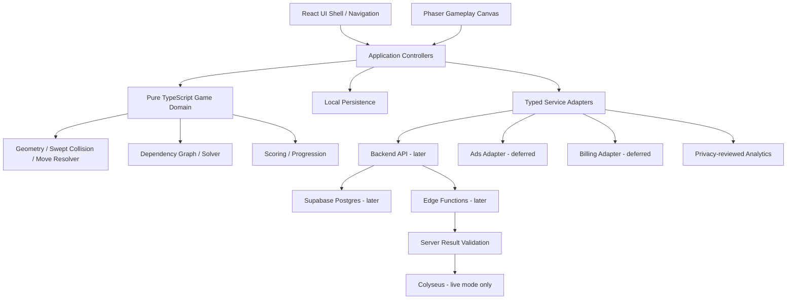

# Architecture and data boundaries

Working revision 2.3 · Derived from masterplan 2.1 · Updated 10 November 2026.

[Index](../README.md) · [Working masterplan](../../MASTERPLAN.md) · [Current amendments](../decisions/README.md)

This page revises source sections 9, 10. The original reference preserves historical wording. Original section numbers are retained for traceability. Source labels such as “Locked”, “checked”, team assignments and framework versions are imported claims, not new approvals or verification. Apply the working amendments before implementation. Commands or instructions in the imported plan are project reference material, not authorization to execute them.

# 9. Architecture 2.0

## 9.1 Technology baseline

| Layer | Baseline candidate | Role / constraint |
|---|---|---|
| UI shell | React + TypeScript + Vite (spike first) | Home, Modes, World, Shop, Ranking, Profile and settings |
| Game runtime | Phaser (verify and pin a compatible version during spike) | Gameplay board, pointer input, path rendering and in-game animation |
| Shared game domain | Pure TypeScript package | Geometry, collision, moves, solver, scoring and progression contracts |
| Mobile runtime | Capacitor (verify compatible core/CLI/plugin versions) | Android packaging, lifecycle and native integrations |
| Unit/property tests | Vitest | Pure rules, geometry, generator and persistence tests |
| Browser E2E | Playwright | Navigation, layout, touch-like input and full-level flows |
| Backend (later) | Supabase Postgres / Auth / Edge Functions | Optional account link, cloud saves, daily challenges and validated results |
| Live service (much later) | Colyseus candidate | Authoritative real-time rooms only if live mode is justified |
| Analytics | Privacy-reviewed adapter | Minimal product measurement; no unnecessary personal data |
| Ads / purchases | AdMob / Play Billing, deferred | Only after eligibility, policy and retention gates pass |
| Source control | GitHub | PR review, CI, releases and issue tracking |

### Framework selection

Use the [build guide](../build-guide.md) for the working candidate stack and implementation sequence. Exact version and release-date claims from 2.1 are not accepted as verified dependencies. Resolve compatible versions, runtime prerequisites and Android tooling in A04, record dated official evidence and commit the lockfile.

React owns menu navigation and Phaser renders the board; application commands connect both to pure domain state. Test touch latency, safe areas, resizing, background/resume, memory and Android packaging on a physical phone before adopting the split. A Phaser-only shell remains a fallback if the bridge does not justify its cost.

## 9.2 Application layers

If the team chooses a Phaser-only app shell after the spike, replace the React box with the selected screen layer. The dependency rule remains: neither UI framework owns puzzle legality or progression truth.

## 9.3 Architecture principles

- Game rules must not depend on Phaser.
- UI must not directly mutate puzzle state.
- All state changes flow through application commands.
- Local play must work offline.
- Backend access goes through typed adapters.
- Third-party SDKs are isolated behind interfaces.
- Analytics, ads and billing must be replaceable.
- Version all level data and generator rules.
- Secrets never ship in the client.
- The client is not authoritative for ranked scores or purchases.

## 9.4 Initial repository structure

Begin with one game package and `src/domain`, `src/application`, `src/game`, `src/ui`, `src/storage`, `content/levels`, `public/assets` and `tests`. The [build guide](../build-guide.md) defines workspace integration and the planned Android directory. No runtime directories have been scaffolded yet. Extract packages only when a real consumer needs them; backend and monetization adapters remain deferred.

## 9.5 Core domain contracts

### `PathGeometry`

- Stores ordered path points.
- Validates orthogonal segments.
- Derives occupied cells/edges.
- Derives head direction.
- Rejects invalid self-intersections.

### `ExitChecker`

- Receives current board state and selected arrow.
- Returns clear/blocked plus blocker information.
- Does not mutate state.

### `MoveResolver`

- Applies a validated move.
- Updates active arrows and occupancy.
- Produces a deterministic state transition.
- Prevents duplicate action commits.

### `LevelSolver`

- Finds a complete removal sequence.
- Supports memoization and bounded search.
- Returns solution metadata.
- Does not render or animate.

### `LevelGenerator`

- Accepts a seed, version and difficulty profile.
- Returns a candidate level and solution.
- Rejects invalid candidates.
- Produces reproducible output.

### `ProgressionService`

- Tracks campaign, world, stars, coins and unlocks.
- Accepts only valid completion records.
- Supports local-first progression.

### `MatchValidator`

- Validates a ranked move trace against the canonical puzzle.
- Reconstructs final state.
- Rejects impossible or inconsistent results.

# 10. Backend and data model

## 10.1 When to introduce backend

Do not add user accounts to the first offline prototype.

Introduce online services when the game needs:

- Cross-device save.
- Daily challenge consistency.
- Leaderboards.
- Friend challenges.
- Inventory synchronization.
- Match history.

## 10.2 Backend recommendation

Supabase remains an unvalidated candidate for a later online layer; reassess requirements and current documentation before selection:

- Postgres for structured game data.
- Auth for optional account linking.
- Edge Functions for server-side actions.
- Realtime for presence or lightweight notifications.
- Row Level Security for per-user data access.

Do not use the client to directly award premium currency or authoritative ranked rewards.

Supabase documentation emphasizes enabling and configuring Row Level Security for exposed tables. Every exposed table must have deliberate privileges and policies.

References:
- Supabase database overview: https://supabase.com/docs/guides/database/overview
- Row Level Security: https://supabase.com/docs/guides/database/postgres/row-level-security
- Realtime authorization: https://supabase.com/docs/guides/realtime/authorization
- Database functions: https://supabase.com/docs/guides/database/functions

## 10.3 Initial data entities

| Entity | Purpose |
|---|---|
| `profiles` | Public player profile and settings |
| `player_progress` | Campaign/world progression |
| `level_results` | Completed level records |
| `wallets` | Coin balance and currency version |
| `wallet_transactions` | Auditable coin changes |
| `owned_cosmetics` | Owned arrow skins and trails |
| `equipped_cosmetics` | Active selections |
| `daily_challenges` | Canonical daily seed/version |
| `challenge_attempts` | Submitted attempts and results |
| `friend_challenges` | Async challenge status |
| `leaderboard_entries` | Validated ranking data |
| `match_history` | Completed multiplayer results |
| `purchase_records` | Verified purchase events |

## 10.4 Data-security requirements

- Enable RLS on exposed tables.
- A player may read/update only permitted own profile fields.
- Wallet balance must not be directly writable by the client.
- Currency changes must be server-validated and ledgered.
- Purchase rewards must be verified through platform receipt/token validation.
- Leaderboards should expose only minimal public display data.
- Private challenge details must not be readable by unrelated users.
- Realtime channel access must be authorized.
- Service-role secrets remain on trusted server infrastructure.
- Rate-limit endpoints that award currency or create matches.

## 10.5 Local-first and account linking

Initial player can use a local guest identity.

When online features launch:

1. Create a guest profile or anonymous session.
2. Keep core progress locally.
3. Offer optional account linking.
4. Merge progress with explicit conflict rules.
5. Never silently overwrite a higher valid progression state.
6. Provide recovery/support process for account migration.

Do not force sign-in for offline campaign play.
