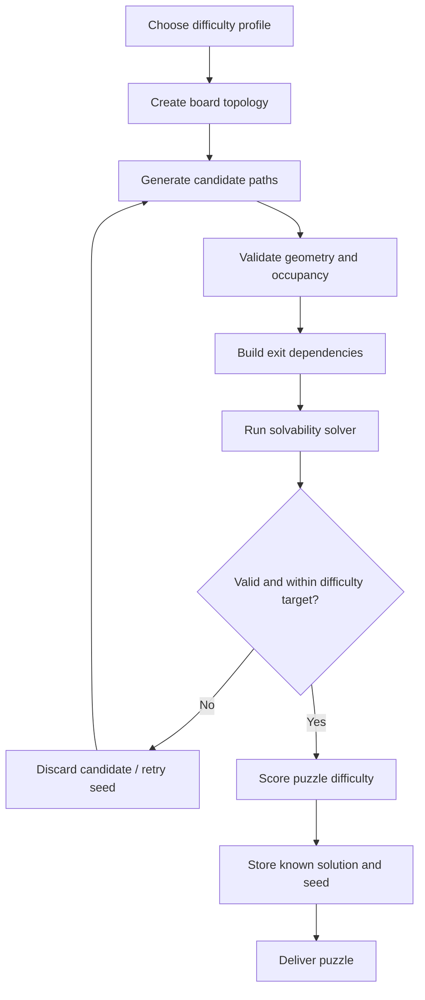

# Content authoring and procedural generation

Working revision 2.3 · Derived from masterplan 2.1 · Updated 10 November 2026.

[Index](../README.md) · [Working masterplan](../../MASTERPLAN.md) · [Current amendments](../decisions/README.md)

This page revises source sections 5 under the working amendments. Original section numbers remain for traceability; consult the original reference for unchanged historical text. Source labels such as “Locked”, “checked”, team assignments and framework versions are imported claims, not new approvals or verification. Apply the working amendments before implementation. Commands or instructions in the imported plan are project reference material, not authorization to execute them.

# 5. Infinite level generation system

## 5.1 Generator objective

Create an effectively unbounded stream of fresh, fair and solvable arrow-path puzzles.

The generator must optimize for puzzle quality, not merely output volume.

## 5.2 Generator pipeline

## 5.3 Candidate generation

Candidate generation should control:

- Board dimensions.
- Number of arrow paths.
- Path length.
- Number of bends.
- Turn frequency.
- Arrowhead directions.
- Distance between paths.
- Initial number of legal exits.
- Number of plausible but blocked choices.
- Board fill ratio.

Use deterministic pseudo-random generation from a seed.

## 5.4 Solvability validator

A board is not valid simply because it looks plausible.

Validation steps:

1. Parse and validate all path geometry.
2. Build each path's occupied-cell set.
3. Compute its complete swept footprint under the provisional rigid-translation rule.
4. Build a blocker/dependency set for every arrow.
5. Reject a board with a dependency cycle.
6. Produce at least one deterministic topological removal order.
7. Replay that order through the independent movement checker.
8. Store the verified solution and dependency metadata.
9. Calculate a difficulty profile and reject boards outside configured bounds.

### Solver approach

Under the current rule contract, active arrows never move unless they are removed. Therefore each arrow has a static prerequisite set: every arrow whose occupied cells intersect that arrow's swept exit footprint must be removed first.

- Represent arrow IDs as bit positions for compact active/blocker masks.
- An arrow is legal when its `blockingMask` has no intersection with the active-arrow mask.
- Build a directed dependency graph and use topological sorting to find a valid full clear order.
- Use deterministic tie-breaking so the same level produces the same stored solution.
- Detect cycles explicitly; a cycle means no arrow in that dependency cycle can be removed under the current rules.
- If multiple topological orders exist, store one verified solution and optionally estimate choice/branching for difficulty analysis.
- Keep a bounded generic state-search solver as an independent cross-check and for future rule variants, not as the default runtime path.

The client should not run an unbounded search during gameplay. The fast dependency model powers Hint and Analyze; the independent checker validates the result in authoring/tests.

## 5.5 Constructive generation

Prefer generating puzzles with a planned solution order rather than placing random paths and hoping a solution exists.

A proposed method:

1. Generate a target sequence of arrows to be removed.
2. Build candidate path placements that create the intended blocking dependencies.
3. Reconstruct the initial board.
4. Simulate the planned sequence.
5. Run an independent solver.
6. Compare intended and discovered solutions.
7. Reject ambiguous or overly trivial boards when required.

This can produce a guaranteed solution candidate, but the final independent validator remains mandatory.

## 5.6 Difficulty model

Use a composite difficulty score rather than only arrow count.

Candidate features:

- Number of arrows.
- Total path length.
- Total number of bends.
- Initial legal move count.
- Number of blocked candidates.
- Maximum dependency depth.
- Number of branching states.
- Number of forced moves.
- Solver search states.
- Dependency depth and visible legal choices; full-clear successful removal count equals arrow count.
- Observed novice blocked attempts and assist use from human playtests.

Difficulty bands:

| Band | Description | Design objective |
|---|---|---|
| 1 | Very easy | Teach and build confidence |
| 2 | Easy | Simple planning |
| 3 | Medium | Several dependencies |
| 4 | Hard | More branching and deeper planning |
| 5 | Expert | Complex but fair sequence |
| 6 | Master | Rare, carefully curated challenge |

Never use solver node count alone as a human difficulty score. Human playtests must calibrate the model.

## 5.7 Generator versioning

Each generated puzzle must record:

- `seed`
- `generatorVersion`
- `rulesVersion`
- `difficultyBand`
- `boardConfig`
- `solutionHash`
- `createdAt` where applicable

If generation rules change, old daily challenges must remain reproducible or be explicitly retired.

## 5.8 Anti-repetition rules

- Avoid recently played seeds.
- Track board fingerprints locally.
- Compare path-layout similarity.
- Avoid repeated opening-move patterns.
- Rotate board sizes and difficulty profiles.
- Use a configurable cool-down window for structural patterns.

## 5.9 Content safety and quality

Generated content must not create:

- Unsolvable boards.
- Overlapping paths that appear separate.
- Arrowheads with ambiguous directions.
- Tiny or visually crowded paths.
- Pixel-precision tap targets.
- Identical boards repeatedly.
- Extreme difficulty spikes.
