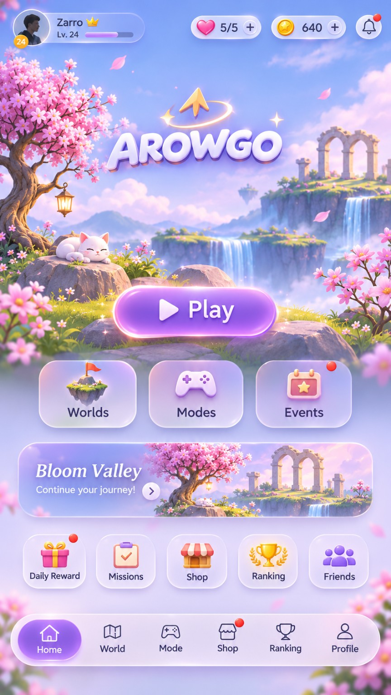
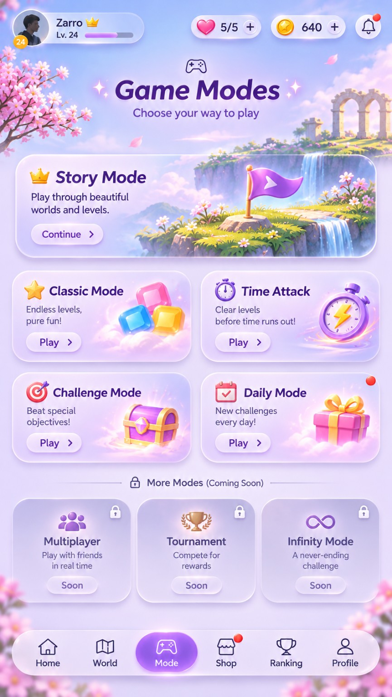
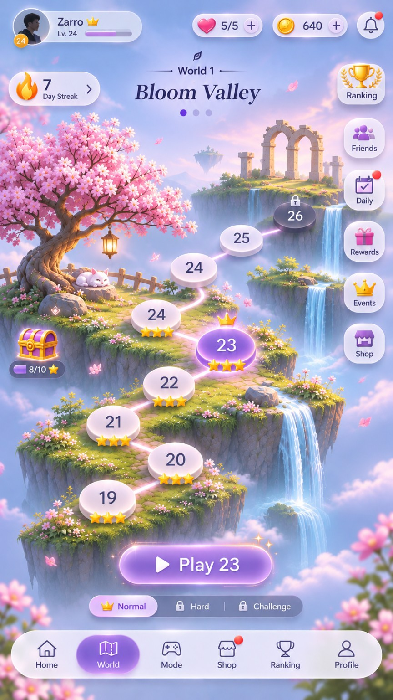
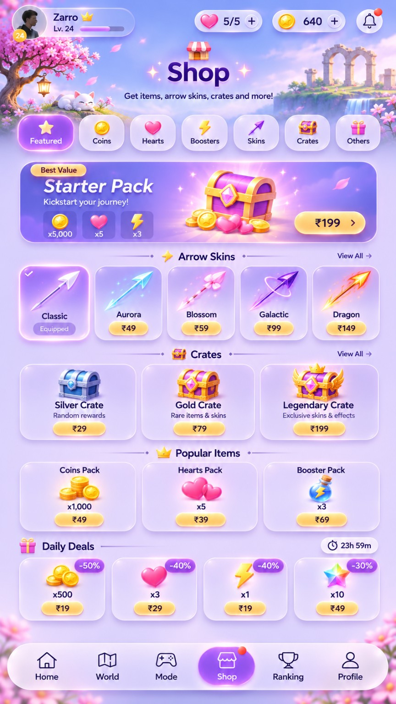
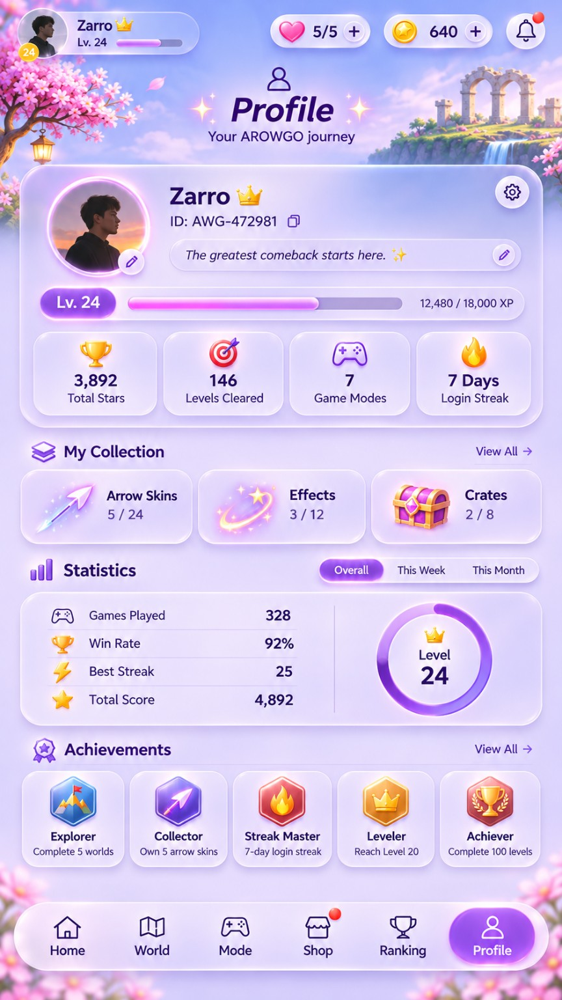
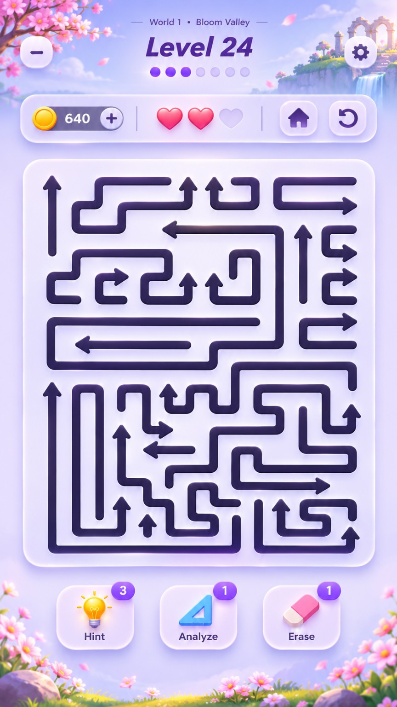

# Reference refresh — 10 November 2026

These six unchanged files were supplied by the user in the latest design request. [Manifest](manifest.json) records original paths and SHA-256 hashes. They are visual direction, not runtime screenshots or executable instructions. The app uses its own live React/SVG layout, existing original scenery, original five-level geometry, and real local progress.

| Reference                   | Applied to our prototype                                                                 | Deliberate adaptation                                                                          |
| --------------------------- | ---------------------------------------------------------------------------------------- | ---------------------------------------------------------------------------------------------- |
| [Home](01-home.png)         | Large dimensional title, luminous Play, three glossy shortcut cards, scenic world banner | Five-level journey; no fabricated notifications, daily gifts, friends or global refill economy |
| [Modes](02-modes.png)       | Prominent Story and Practice cards with distinct visual motifs                           | Two real modes; no dead multiplayer/tournament buttons                                         |
| [World](03-world.png)       | Winding progression trail, numbered stops, current-level glow and earned stars           | Five unique levels; only cleared predecessors unlock the next; compact landscape row           |
| [Shop](04-shop.png)         | Collectible visual treatment and clear earned/locked states                              | Earned milestone collection on Progress; no purchases, crates, false discounts or prices       |
| [Profile](05-profile.png)   | Journey summary, progress emphasis and achievement tiles                                 | Actual completed levels, stars and coins; no invented identity, XP or win rate                 |
| [Gameplay](06-gameplay.png) | Rounded quiet board, dark vector arrows, compact HUD and glossy tools                    | Focused viewport, Hint/Erase only, three mistake hearts, no bottom navigation                  |

