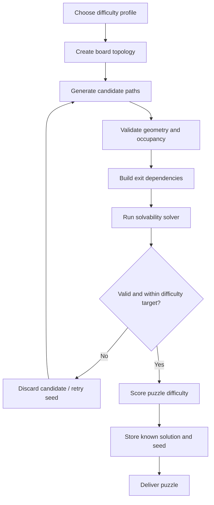
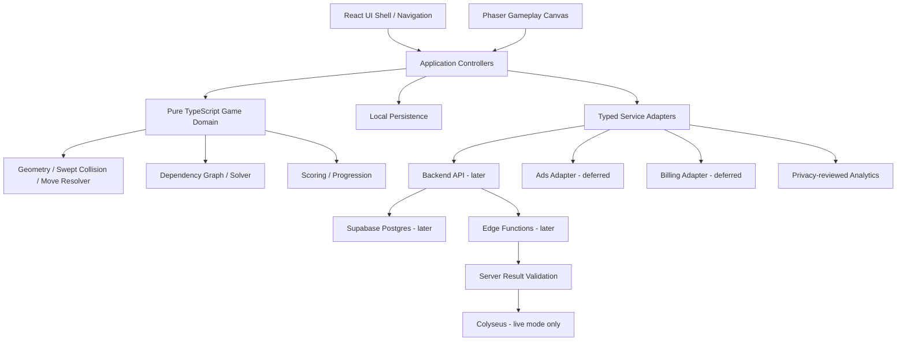

# AROWGO — Advanced Game Development Masterplan 2.1

**Document:** Complete Product, Engineering, Content, Growth and Live-Ops Specification  
**Version:** 2.1  
**Prepared:** 10 November 2026  
**Product:** AROWGO  
**Genre:** Casual path-extraction / logic puzzle  
**Primary platform:** Android  
**Prototype platform:** Web / PWA  
**Working tagline:** Think. Clear. Go.  
**Status:** Pre-production / implementation-ready baseline, with core rules awaiting prototype validation  
**Naming status:** AROWGO is a working product name. Store, domain, social-handle and trademark clearance remain outstanding.

---

## Document purpose

This is the working source of truth for the AROWGO team. It translates the supplied Level 24 gameplay reference into an implementable product plan, defines a scalable technical architecture, establishes release gates, and maps the game's future systems.

The document distinguishes:

- **Product decisions:** proposed rules and features the team should build.
- **Validation hypotheses:** ideas that must be tested with players.
- **Later-phase capabilities:** features that should not delay the first playable release.
- **Compliance checks:** requirements that must be re-verified with the relevant platform and qualified advisers before launch.

The team must update this document when a product decision changes. Do not silently build a different game mechanic from the one described here.

## How to use Masterplan 2.1

This revision tightens the implementation contract and makes the release scope more realistic. It does not turn every concept screen into an MVP requirement.

**Priority labels**

- **P0 — Prototype blocker:** must be decided or implemented before the core mechanic can be trusted.
- **P1 — MVP:** required for the first public-quality single-player release.
- **P2 — Post-MVP:** build only after the core game has passed external playtests.
- **P3 — Long-term:** advanced features that require proven demand and an operating plan.

**Decision states**

- **Locked:** the team has agreed and implementation may proceed.
- **Provisional:** use this default in the prototype; revisit only with evidence.
- **Validate:** must be tested against the playable reference or with players.
- **Deferred:** explicitly out of the current release scope.

The current highest-risk dependency is the exact movement/collision rule for a bent arrow. Do not scale level production, generator work or monetization until that rule is demonstrated and covered by tests.

### 2.1 revision summary

1. Reconciles the six supplied visual directions: Home, Modes, World, Shop, Profile and Gameplay. Ranking is specified as a missing screen rather than assumed complete.
2. Replaces the ambiguous arrowhead-only exit-ray check with a provisional rigid-path movement contract that checks the entire swept path. This is the most important gameplay clarification and must be validated in the first prototype.
3. Makes the game domain independent of Phaser and specifies deterministic replayable move results.
4. Defines Story, Classic, Daily, Time Attack, Challenge, Multiplayer and Infinity as separate concepts, while deferring overlapping or expensive modes.
5. Reduces the first release to a polished offline-first single-player campaign. Backend, ads, purchases, ranked competition and live multiplayer move behind evidence-based gates.
6. Resolves the conflict between the shop mockup's crates and the policy of avoiding paid random rewards: no paid randomized crates in the first release.
7. Adds missing Profile and Ranking screen specifications, content-authoring requirements, release operations and clearer test gates.
8. Updates framework and publishing references checked on 10 November 2026. Recheck them again immediately before implementation and submission.

The screenshots are visual references, not a substitute for functional acceptance criteria. Every feature must have a testable behaviour and a release priority.

# 1. Executive direction

## 1.1 Product vision

AROWGO is a premium-feeling, easy-to-understand mobile puzzle game built around long, bent arrow paths. Players inspect a dense board, identify arrows whose exit is clear, remove them in a valid order, and gradually solve more complex arrangements.

The experience should feel:

- Soft, calm and polished.
- Immediately understandable.
- Deep enough to reward planning.
- Satisfying through movement, sound and feedback.
- Replayable through curated campaigns, daily puzzles and endless generation.
- Socially competitive without requiring real-time interaction in the first release.

## 1.2 Product pillars

| Pillar | Player promise | Business purpose |
|---|---|---|
| Puzzle | Read the board, find the safe exit, clear the paths | Core engagement |
| Progression | Move through worlds, levels, challenges and milestones | Long-term return |
| Collection | Personalize arrow appearances and trails | Cosmetic economy |
| Competition | Compare performance and challenge friends | Sharing and retention |

## 1.3 Business hypothesis

A small game can become a durable product if it combines:

1. A core puzzle loop that players genuinely enjoy.
2. A repeatable way to generate or curate good levels.
3. Reliable distribution through short-form content, communities and store discovery.
4. Respectful monetization that does not damage retention.
5. A content and live-ops system that gives players reasons to return.

The team must not assume that more features automatically produce more revenue. Retention, distribution and unit economics must be measured before scaling.

## 1.4 North-star metric

**Weekly engaged puzzle solvers:** unique players who complete at least three valid levels in a seven-day period.

Supporting metrics:

- New-player tutorial completion.
- First-session level completion.
- Day-1, Day-7 and Day-30 retention.
- Levels completed per active player.
- Endless-mode session completion.
- Daily challenge participation.
- Share-to-install conversion.
- Revenue per daily active user.
- Crash-free sessions.

Downloads and video views are acquisition signals, not proof of a healthy game.

# 2. Product reference and visual direction

## 2.1 Authoritative visual references

The current AROWGO visual direction is represented by the user-provided screen set:

- **Home:** cherry-blossom fantasy environment, clear Play action, profile/level HUD, currency and heart counters, world/mode/event shortcuts, featured world banner, secondary shortcuts and bottom navigation.
- **Modes:** Story Mode hero card, Classic, Time Attack, Challenge and Daily cards; advanced modes are visibly locked and marked as coming later.
- **World:** a vertical floating-island level route, clear current-level focus, completed/locked states, stars, streak/reward shortcuts and a strong Play action.
- **Shop:** category tabs, featured offer, arrow-skin previews, crates, popular items and daily deals. Prices and random-reward mechanics shown in concept art are placeholders, not approved economy decisions.
- **Profile:** player identity, level/XP, stats, collection, achievements and a clear settings entry.
- **Gameplay:** compact level header, currency and heart state, central high-contrast board, and Hint / Analyze / Erase tools.

Preserve the overall visual language: soft lavender/pink atmosphere, fantasy floating islands, cherry blossoms, waterfalls, rounded translucent panels, playful 3D iconography and crisp dark-navy puzzle geometry. The game board must remain more legible than the decorative world art.

The Ranking destination is present in the navigation concept but a dedicated ranking screen was not included in the supplied reference set. Its functional specification is added in Section 16; visual design remains to be produced.

## 2.2 Design principle

**Crisp puzzle geometry + soft interface chrome.**

Do not make the paths themselves blurry or excessively glossy. The maze must be easy to read. Use the soft depth, gradients, shadows and highlights primarily on panels, buttons, counters and completion effects.

## 2.3 Visual design system

### Colour direction

| Token | Intended use | Starting value |
|---|---|---|
| `bg.primary` | Main app background | `#F7F5FF` |
| `bg.secondary` | Lavender ambient surface | `#EEEAFE` |
| `surface.card` | Board and panel surfaces | `#FFFFFF` |
| `path.default` | Main arrow paths | `#222944` |
| `path.blocked` | Temporary blocked feedback | `#E76B82` |
| `accent.purple` | Primary actions and active states | `#9169E8` |
| `accent.blue` | Analyze tool | `#65A9E8` |
| `accent.yellow` | Coins and hint tool | `#F3C64D` |
| `accent.pink` | Erase and selected cosmetics | `#ED91B8` |
| `text.primary` | Main text | `#20243A` |
| `text.secondary` | Supporting text | `#77768E` |

These are initial design tokens, not final colour values. Check contrast on real devices.

### Shape and depth

- Rounded main board, approximately 24–30 dp corner radius.
- Rounded status capsule with restrained ambient shadow.
- Buttons large enough for comfortable touch interaction.
- Path strokes use consistent widths and rounded joins.
- Arrowheads are distinct from path corners.
- Avoid excessive neumorphic shadows that reduce contrast.
- Use a small number of elevation levels consistently.

### Typography

Use a legible modern sans-serif. Prefer a clean geometric family with strong numerals. Level numbers, coin balance, tool counts and move counts must remain readable at common Android sizes.

### Motion principles

- Responsive input before decorative motion.
- Short, clear feedback.
- Smooth path withdrawal when an arrow is cleared.
- Minimal screen bounce.
- Reduced-motion setting must be respected.
- No animation may hide a puzzle state change.

## 2.4 Motion specification

| Interaction | Suggested motion | Purpose |
|---|---|---|
| Valid arrow exit | Arrowhead leads; path retracts/follows with a soft trail | Satisfying removal |
| Blocked selection | Brief path pulse and blocker highlight | Explain why the move failed |
| Hint | Soft highlight travels along the recommended arrow | Direct attention |
| Analyze | All currently clear arrows receive a temporary outline | Reveal available choices |
| Erase | Selected path fades and particles disperse | Confirm consumable action |
| Level completion | Board clears, star/score reveal, next action appears | Reward |
| Coin reward | Small coin movement toward HUD counter | Reinforce earning |
| Skin equip | Short material / colour transition | Confirm customization |
| World unlock | Path-node activation and gentle reveal | Progress feedback |

Do not lock the input system for long animation sequences. Gameplay state must be updated deterministically before or during the animation according to one documented rule.

## 2.5 UI consistency rules from the screen set

- **Three surface levels only:** (1) primary action / active selection with the strongest purple treatment, (2) translucent glass cards for secondary actions, and (3) simple flat surfaces for low-priority information. Do not give every element the same glow, blur and shadow.
- **Gameplay contrast wins:** arrow paths use a stable dark-navy treatment. Skins may add material, edge tint or a small trail, but may not reduce contrast or alter hitboxes.
- **One primary action per screen:** Play / Continue on Home, Continue on the Story card, Play on the selected level, Equip or Buy on an item detail, and one clear next action on Results.
- **Stable chrome:** profile HUD and bottom navigation should retain consistent sizing and placement across non-gameplay screens. Gameplay may use a compact HUD, but its counters and icon meanings must match the rest of the app.
- **Navigation:** Home, World, Mode, Shop, Ranking and Profile are the six primary destinations shown in the concept. On small devices, prevent the bottom bar from covering scrollable content or the gameplay board.
- **Use restrained motion:** reserve the strongest animated treatment for successful arrow exits, level completion, unlocks and important rewards. Ambient petals and background particles must not compete with text or taps.
- **Responsive composition:** design for a narrow Android portrait viewport first, then test larger phones and web widths. Never solve a layout overflow by shrinking touch targets or puzzle paths below readable sizes.
- **Asset hierarchy:** decorative world backgrounds may be rich and soft; buttons, text, icon silhouettes, path geometry and arrowheads must have crisp edges.
- **No UI copy baked into artwork:** all labels, counters, prices, badges and state messages must be real interface text so they can be localized and updated.

The screenshot set is a direction baseline. Do not copy accidental AI-rendered text artefacts, inconsistent numbers, duplicate items or decorative UI errors from a mockup.

# 3. Core gameplay specification

## 3.1 Gameplay interpretation — P0, validate before content production

The current working interpretation is that every arrow is a one-cell-wide bent path that translates as one rigid object in the direction shown by its arrowhead. The entire path must be able to slide out of the board without touching another active path.

This replaces the less precise idea that only the arrowhead's straight exit ray is checked. A clear ray from the arrowhead is not sufficient if another path blocks the body of the moving arrow during its exit.

**Provisional rule contract**

1. Each arrow is one connected orthogonal polyline made of occupied board cells.
2. Its arrowhead is at the final point in its ordered path.
3. The arrowhead faces outward along the final path segment. Direction is derived from the last two distinct points, not stored as an unrelated direction that could disagree with the path.
4. When selected, the entire arrow translates one grid cell at a time in that direction.
5. At every translation step, every in-board cell occupied by the moving arrow is checked against all other active arrows.
6. If any other active arrow overlaps the moving arrow's translated footprint at any step before the entire arrow leaves the board, the move is blocked.
7. If the full arrow can leave the board, it is removed as one successful action.
8. A blocked attempt does not change path occupancy or progression state. It may consume one mistake heart in the standard campaign rule described below.

**Prototype validation is mandatory.** Confirm that rigid translation is the intended interpretation of the supplied gameplay reference. If the intended mechanic is instead a path-only ray check or a different extraction behaviour, update this contract, examples, solver, generator and tests together before producing campaign content.

## 3.2 Core state model

A level contains:

- Board width and height in logical cells.
- Active arrow objects and stable IDs.
- Ordered orthogonal path waypoints.
- A derived list/set of cells occupied by each path.
- The arrowhead endpoint and derived outward direction.
- Collision occupancy indexed by arrow ID.
- Level metadata, rules version and difficulty profile.
- A known solution order for curated and generated levels.
- Optional target move count and scoring metadata.

The domain model is independent of screen pixels, Phaser objects, React components and animation state.

### Proposed level data example

```json
{
  "schemaVersion": 1,
  "rulesVersion": 1,
  "levelId": "world_01_level_024",
  "board": { "columns": 12, "rows": 12 },
  "arrows": [
    {
      "id": "arrow_a",
      "points": [[1, 1], [4, 1], [4, 3], [7, 3]]
    }
  ],
  "solution": ["arrow_a"],
  "targetMoves": 1
}
```

`points` are ordered from the tail endpoint to the arrowhead endpoint. Each waypoint is an integer cell coordinate. A segment between adjacent waypoints is expanded into every occupied cell along that horizontal or vertical run. The arrowhead is attached to the last point; its outward direction is the direction from the penultimate point to the final point.

The schema should be validated at load time. Reject malformed data rather than trying to repair it silently.

## 3.3 Path representation and geometry constraints

Use integer cell coordinates for the logical board. Each path is a compressed orthogonal polyline; the renderer expands it into smooth rounded corners and a visible arrowhead.

**P0 geometry constraints**

- At least two distinct points per arrow.
- Horizontal or vertical segments only.
- No zero-length consecutive segments.
- No immediate reversal / 180-degree U-turn.
- No repeated occupied cell within one path.
- No self-intersection or self-overlap.
- No overlap between different initial paths.
- Every point and expanded cell is inside the board at level start.
- Final segment must establish one unambiguous arrowhead direction.
- Minimum clearance and visual stroke width are configuration values shared by validator and renderer.

For the first version, paths are one logical cell wide. If visual stroke width is wider than one cell, the renderer must preserve a consistent gap and the collision model must not pretend that visually overlapping paths are separate. Add bridges or crossings only as explicit future topology objects, never as accidental visual overlaps.

Do not use rendered pixels as the source of truth for collision detection.

## 3.4 Exit validation — whole-path swept-volume check

For a selected arrow:

1. Read the arrow's expanded occupied-cell set and derived direction vector `d`.
2. Determine the number of one-cell translations required for the entire path bounding box to move beyond the board boundary in direction `d`.
3. For each translation step `k`, calculate the moving footprint `P + (k × d)`.
4. Intersect the in-board cells in that footprint with occupancy belonging to every other active arrow. Ignore the selected arrow's own old footprint; do not ignore any other arrow.
5. If an overlap exists at any step, return `blocked` with the first blocker ID, cell and translation step.
6. If no overlap exists through the final exit step, return `clear` with the required translation distance.
7. The checker must be pure and must not mutate board state.

### Dependency representation

Because an arrow remains stationary until removed and successful moves only remove arrows, the set of arrows that obstruct a candidate arrow can be precomputed for a fixed level. Store a `blockingArrowIds` set or bitmask for each arrow.

An arrow is currently legal when none of its blocking arrows remain active. Removing an arrow can only preserve or increase the set of legal moves; it can never make a previously clear arrow blocked. This monotonic property should be tested against the reference mechanic.

Use the dependency representation for fast hints, Analyze and solver operations. Keep a slower, independent swept-volume checker in tests as the correctness oracle so a bug in dependency precomputation cannot silently validate bad content.

## 3.5 Move resolution and animation transaction

A valid removal should:

1. Accept one input command and assign an action/sequence ID.
2. Ignore duplicate pointer events while that arrow is resolving.
3. Validate the move against the current immutable logical state.
4. Commit the logical removal exactly once.
5. Rebuild or incrementally update active-arrow and occupancy indexes.
6. Update move count, mistake count, assist flags and score inputs.
7. Trigger the exit animation from the committed result.
8. Check completion and issue one completion event only.
9. Persist the new state at a safe checkpoint.

The animation is a view of an already-decided state transition. It must never decide whether a move is legal. On app suspension or a rendering failure, restore the committed state without duplicating the reward or move.

A blocked move should:

1. Return the blocker and collision location from the pure checker.
2. Highlight the selected arrow and blocker briefly.
3. Leave occupancy and progression unchanged.
4. Apply at most one configured mistake penalty for the user action, not one penalty per touch/pointer event.
5. Respect reduced-motion and sound/haptic settings.

State transitions should be replayable in tests from an initial level plus an action log.

## 3.6 Hearts / mistakes

The canonical heart, retry and scoring rules are consolidated in Section 3.9. Keep that section as the single source of truth; do not implement a separate app-wide energy/lives system.

## 3.7 Coin economy — provisional, not monetized in MVP

Coins are a soft progression currency. They are not required to finish a level or unlock the next campaign level.

**MVP rules**

- Coins are earned through first-time level completion, world milestones and achievements.
- The balance is stored locally with an append-only transaction history, even before cloud sync exists.
- Coins may be spent on directly previewable cosmetics only.
- No real-money coin packs, paid crates or randomized paid rewards ship in the first release.
- Do not sell extra hearts or make a puzzle solvable only after a purchase.
- Rewarded-ad coin rewards are deferred until a policy-checked monetization experiment.

The Shop mockup contains rupee prices and crates. Treat those prices as visual placeholders. For the first shop implementation, use earned coins and direct cosmetic unlocks. A crate visual may be used for a deterministic, clearly disclosed reward bundle; do not sell a paid random outcome.

Currency reward amounts and cosmetic prices must be tuned with playtest data. Never hard-code mockup prices as approved store pricing.

## 3.8 Bottom tools

The gameplay reference shows three tools. Their meanings must remain stable throughout the game.

### Hint — P1

- Shows one currently legal arrow.
- Uses the verified level solution or current dependency model.
- Highlights the arrow; it does not remove it automatically.
- Decrements a charge only after a usable hint has been delivered.
- If no valid hint can be produced, do not charge the player.

### Analyze — P1

- Shows every currently legal arrow.
- Uses the same rule engine as normal selection.
- Temporarily outlines all available exits without changing state.
- Decrements a charge only after the analysis has completed.
- Is unlimited in the tutorial.

### Erase — P1, validate in prototype

- Player selects one arrow and confirms the action.
- The selected arrow is removed without checking its exit corridor.
- The action updates occupancy and completion state exactly like a successful removal, but marks the run as assisted.
- It must not award an unassisted / perfect ranked result.
- It must be cancellable before confirmation.
- It must not be required to complete any curated level.

### Charge and fairness policy

The small badges shown on the tools represent available charges. Initial values are balancing parameters, not promises. In the MVP, charges are earned through normal progression and/or supplied as a fixed tutorial allowance. Do not introduce paid refills until retention, player sentiment and platform requirements have been reviewed. Ranked or competitive modes disable paid and consumable assists.

## 3.9 Hearts, scoring and completion contract

- Standard Story levels provisionally start with three mistake hearts.
- A blocked attempt consumes one heart; successful removals do not.
- Practice and tutorial levels may use relaxed or unlimited mistakes.
- At zero hearts, show a clear retry/restart choice. Do not force a purchase or wait timer.
- Hearts are a per-level mistake budget, not an app-wide energy system and not a time-gated life system.
- Campaign stars are based primarily on completion, moves relative to a target and whether assists were used. Time is not a campaign star requirement.
- Time Attack may use time as a primary score input only after that mode is built.
- Every completion and reward must be granted once, even if the app closes during the result animation.
- Results must show stars, moves, mistakes, assists, earned coins and next action.

## 3.10 Level authoring and validation — P1

Every authored level must pass:

1. Schema validation.
2. Geometry validation.
3. Initial overlap and clearance validation.
4. Swept-volume collision validation for every arrow.
5. Dependency graph construction.
6. Solvability check (at least one topological removal order).
7. Stored solution verification by replaying the sequence through the independent move checker.
8. Target-move and difficulty metadata validation.
9. Device-scale visual review.
10. Human playtest for levels that introduce a new mechanic or difficulty band.

Create a small internal level previewer/editor before producing 100+ levels. At minimum it must load JSON, render the path layout, display blockers/dependencies, run the solver, replay the solution and export validated level data. This avoids editing raw JSON without visual feedback.

# 4. Game modes

## 4.1 Story Mode / Campaign — P1

Story Mode is the main guided experience shown in the Modes reference. It is curated, sequential and organized into themed worlds.

Initial content target:

- Vertical slice: 10–15 levels.
- First external MVP: 30–40 curated levels that have been manually reviewed.
- Expansion target: 100 levels across five worlds after quality and retention evidence.

Do not delay the first playable build until 100 levels exist.

### Suggested world themes

| World | Name | Visual direction | Difficulty |
|---|---|---|---|
| 01 | Bloom Valley | Lavender, cherry blossom, waterfalls | Tutorial and easy |
| 02 | Azure Isles | Blue, pearl and clouds | Easy to medium |
| 03 | Rosewood Garden | Pink and violet flora | Medium |
| 04 | Twilight Labyrinth | Deep navy and lilac | Medium to hard |
| 05 | Golden Horizon | Warm gold and purple | Hard |

World themes may change scenery, ambient effects and reward styling. They must not change path contrast or collision rules.

## 4.2 Classic Mode — P2

Classic is the untimed repeat-play mode shown in the Modes reference. Before implementation, decide whether it is:

- a sequence of independent levels with no timer and no campaign unlock requirement; or
- an endless run that ends on a defined failure condition.

Do not ship both definitions under one name. The preferred first experiment is a simple endless sequence with no timer, a clear run-end rule and reproducible seeds. It must remain distinct from any future Infinity mode.

## 4.3 Daily Mode — P2

A daily puzzle uses one canonical board seed and rules/generator version per day.

- Same puzzle for all eligible players on that date.
- One clearly stated attempt policy.
- Result card and personal completion history.
- Streak tracking that does not punish timezone changes or app outages.
- Leaderboard only after server validation exists.
- A local fallback may offer a daily puzzle offline, but it must not be presented as the globally ranked puzzle unless the canonical daily data is available.

## 4.4 Time Attack — P2

Time Attack is a separate mode, not a timer added casually to Story levels.

Define before building:

- Whether the timer counts down or measures elapsed time.
- Whether the player gets one board or a sequence.
- Whether blocked moves cost time, hearts or both.
- Pause/background behaviour.
- Tie-break and result validation rules.

Campaign progression and accessibility must not depend on playing under time pressure.

## 4.5 Challenge Mode — P2

Challenge Mode uses curated objective modifiers such as a move limit, no-assist clear, fixed tool allowance or a specific board objective. Every challenge must state the objective before the player starts and provide a validated solution.

## 4.6 Multiplayer and Tournament — P3

The Modes reference shows these as locked / coming soon. Keep them visibly disabled until a real release date and server capability exist. Do not show fake queues, fake player counts or misleading unlock progress.

Build in this order: daily result validation, asynchronous friend challenge, ranked asynchronous competition, and only then live 1v1. Tournaments require a moderation, schedule, support and anti-cheat plan.

## 4.7 Infinity Mode — P3 / differentiation required

Infinity must not duplicate Classic. Keep it deferred until the team can describe a genuinely different loop, such as a high-difficulty survival run with escalating pressure and a finite failure budget. Validate the distinction with players before allocating art or engineering time.

## 4.8 Practice Mode — P1 utility

Practice is a no-pressure entry point rather than a major mode card. It should allow replay of unlocked campaign levels with relaxed mistake rules and no ranked result.

# 5. Infinite level generation system

## 5.1 Generator objective

Create an effectively unbounded stream of fresh, fair and solvable arrow-path puzzles.

The generator must optimize for puzzle quality, not merely output volume.

## 5.2 Generator pipeline



## 5.3 Candidate generation

Candidate generation should control:

- Board dimensions.
- Number of arrow paths.
- Path length.
- Number of bends.
- Turn frequency.
- Arrowhead directions.
- Distance between paths.
- Initial number of legal exits.
- Number of plausible but blocked choices.
- Board fill ratio.

Use deterministic pseudo-random generation from a seed.

## 5.4 Solvability validator

A board is not valid simply because it looks plausible.

Validation steps:

1. Parse and validate all path geometry.
2. Build each path's occupied-cell set.
3. Compute its complete swept footprint under the provisional rigid-translation rule.
4. Build a blocker/dependency set for every arrow.
5. Reject a board with a dependency cycle.
6. Produce at least one deterministic topological removal order.
7. Replay that order through the independent movement checker.
8. Store the verified solution and dependency metadata.
9. Calculate a difficulty profile and reject boards outside configured bounds.

### Solver approach

Under the current rule contract, active arrows never move unless they are removed. Therefore each arrow has a static prerequisite set: every arrow whose occupied cells intersect that arrow's swept exit footprint must be removed first.

- Represent arrow IDs as bit positions for compact active/blocker masks.
- An arrow is legal when its `blockingMask` has no intersection with the active-arrow mask.
- Build a directed dependency graph and use topological sorting to find a valid full clear order.
- Use deterministic tie-breaking so the same level produces the same stored solution.
- Detect cycles explicitly; a cycle means no arrow in that dependency cycle can be removed under the current rules.
- If multiple topological orders exist, store one verified solution and optionally estimate choice/branching for difficulty analysis.
- Keep a bounded generic state-search solver as an independent cross-check and for future rule variants, not as the default runtime path.

The client should not run an unbounded search during gameplay. The fast dependency model powers Hint and Analyze; the independent checker validates the result in authoring/tests.

## 5.5 Constructive generation

Prefer generating puzzles with a planned solution order rather than placing random paths and hoping a solution exists.

A proposed method:

1. Generate a target sequence of arrows to be removed.
2. Build candidate path placements that create the intended blocking dependencies.
3. Reconstruct the initial board.
4. Simulate the planned sequence.
5. Run an independent solver.
6. Compare intended and discovered solutions.
7. Reject ambiguous or overly trivial boards when required.

This can produce a guaranteed solution candidate, but the final independent validator remains mandatory.

## 5.6 Difficulty model

Use a composite difficulty score rather than only arrow count.

Candidate features:

- Number of arrows.
- Total path length.
- Total number of bends.
- Initial legal move count.
- Number of blocked candidates.
- Maximum dependency depth.
- Number of branching states.
- Number of forced moves.
- Solver search states.
- Optimal solution length.
- Difference between optimal and likely novice move counts.

Difficulty bands:

| Band | Description | Design objective |
|---|---|---|
| 1 | Very easy | Teach and build confidence |
| 2 | Easy | Simple planning |
| 3 | Medium | Several dependencies |
| 4 | Hard | More branching and deeper planning |
| 5 | Expert | Complex but fair sequence |
| 6 | Master | Rare, carefully curated challenge |

Never use solver node count alone as a human difficulty score. Human playtests must calibrate the model.

## 5.7 Generator versioning

Each generated puzzle must record:

- `seed`
- `generatorVersion`
- `rulesVersion`
- `difficultyBand`
- `boardConfig`
- `solutionHash`
- `createdAt` where applicable

If generation rules change, old daily challenges must remain reproducible or be explicitly retired.

## 5.8 Anti-repetition rules

- Avoid recently played seeds.
- Track board fingerprints locally.
- Compare path-layout similarity.
- Avoid repeated opening-move patterns.
- Rotate board sizes and difficulty profiles.
- Use a configurable cool-down window for structural patterns.

## 5.9 Content safety and quality

Generated content must not create:

- Unsolvable boards.
- Overlapping paths that appear separate.
- Arrowheads with ambiguous directions.
- Tiny or visually crowded paths.
- Pixel-precision tap targets.
- Identical boards repeatedly.
- Extreme difficulty spikes.

# 6. Level pages, worlds and progression

## 6.1 Information architecture

Primary bottom navigation from the supplied Home concept:

```text
Home | World | Mode | Shop | Ranking | Profile
```

Primary routes:

```text
Home
├── Continue → current Story level
├── Events / Daily reward / Missions (when active)
└── Notifications (only when there is a real notification)

World
├── World map
├── World detail
└── Level list / selected level

Mode
├── Story
├── Classic (post-MVP)
├── Time Attack (post-MVP)
├── Challenge (post-MVP)
├── Daily (post-MVP)
└── Multiplayer / Tournament / Infinity (deferred)

Shop
├── Featured
├── Arrow skins / trails / effects
└── Earned reward bundles (directly disclosed)

Ranking
├── Personal best (offline MVP)
└── Daily / weekly / all-time leaderboard (online, later)

Profile
├── Player identity and progression
├── Statistics and achievements
├── Collection
└── Settings / support / data controls
```

The World and Mode concepts should not be duplicated as separate, confusing entry points. Home's World and Mode tabs open those destinations; the Home screen's shortcut cards may deep-link to the same routes.

## 6.2 Campaign world map

Each world card should show:

- World number and title.
- Visual theme.
- Completed levels.
- Total levels.
- Star progress.
- Unlock state.
- Best score or completion percentage.
- One obvious Continue action.

## 6.3 Level list page

Use both a visual path map and a compact numbered grid.

### Level tile states

| State | Visual |
|---|---|
| Locked | Muted surface and lock icon |
| Unplayed | Clear neutral tile and number |
| Current | Purple highlight and subtle glow |
| Completed | Completion mark and earned stars |
| Perfect | Special border or small crown/star |
| Daily | Distinct daily marker |
| Challenge | Competition badge |

### Level list requirements

- Levels are grouped by world.
- Page loads quickly.
- Current level is visible immediately.
- Completed level results are preserved.
- Players can replay unlocked levels.
- Locked levels explain the unlock requirement.
- The map must remain usable with hundreds of levels.
- Do not require players to scroll through thousands of nodes.

## 6.4 Progression and scoring

Potential score inputs:

- Completion.
- Moves relative to a target.
- Mistakes.
- Hint usage.
- Erase usage.
- Time, where time is appropriate.

Use stars to communicate quality, not to punish players for taking time.

For casual campaign play, accessibility and enjoyment should matter more than speed.

For ranked modes, assisted actions should be treated consistently and transparently.

# 7. Arrow skins and customization

## 7.1 Collection philosophy

Cosmetics should increase emotional attachment without changing puzzle difficulty.

A skin may change:

- Path material.
- Arrowhead style.
- Colour treatment.
- Exit trail.
- Clear animation particles.
- Optional sound accent.

A skin must never obscure the path, change hitboxes or give a competitive information advantage.

## 7.2 Collection categories

| Collection | Visual concept |
|---|---|
| Classic | Dark navy path |
| Candy | Soft pink and pastel |
| Neon | Controlled luminous outline |
| Gold | Warm metallic treatment |
| Crystal | Translucent glass material |
| Nature | Leaf-inspired accents |
| Galaxy | Starfield and violet accents |
| Seasonal | Festival, winter and limited-time themes |

## 7.3 Rarity

Suggested presentation labels:

- Common
- Uncommon
- Rare
- Epic
- Special

Rarity is a collection label, not a promise of value or resale.

Avoid paid random loot boxes. Use clear unlock conditions and direct purchase options where appropriate.

## 7.4 Unlock routes

- Campaign milestones.
- Star milestones.
- Daily challenge streaks.
- Achievement completion.
- Event participation.
- Earned coins.
- Direct cosmetic purchase.
- Optional rewarded ad for a clearly disclosed temporary trial, if testing shows value.

## 7.5 Collection screens

Collection screen should include:

- Category tabs.
- Owned / locked state.
- Preview before equipping.
- Equip button.
- Unlock condition.
- Cosmetic set completion.
- Search/filter only when the inventory becomes large.

A player must always be able to preview the skin in the actual gameplay board.

# 8. Multiplayer and social architecture

## 8.1 Multiplayer rollout

Do not begin with real-time multiplayer.

Build in this order:

1. Daily challenge leaderboard.
2. Asynchronous friend challenge.
3. Ranked asynchronous competition.
4. Live 1v1 race.
5. Seasonal competitions and teams, only if demand supports them.

This provides competitive value before the team operates a real-time multiplayer service.

## 8.2 Daily leaderboard

All players receive the same daily puzzle seed.

Leaderboard ordering should be based on a documented deterministic rule.

Suggested ranking order:

1. Completed beats incomplete.
2. Fewer mistakes.
3. Fewer assisted actions.
4. Fewer moves above the target.
5. Faster completion as a tie-breaker.

The exact order must be tested for fairness and published in the game.

## 8.3 Asynchronous 1v1 challenge

Flow:

1. Player A selects Challenge Friend.
2. Server issues a challenge ID and canonical level seed.
3. Player A shares a link or code.
4. Player B opens the challenge.
5. Both players receive identical rules and level data.
6. Each completes the puzzle independently.
7. Server validates the submitted move trace.
8. Results are compared.
9. Winner and match summary are displayed.

The players do not need to be online at the same time.

## 8.4 Ranked mode rules

- No paid hints or erase actions in ranked matches.
- Cosmetic skins must not affect gameplay.
- Same generator and rules version for both players.
- No changing the board after the match begins.
- Time and move rules must be visible before play.
- Disconnect and app interruption rules must be explicit.
- Do not mix casual and ranked scores.

## 8.5 Live 1v1 mode — later phase

Potential format:

- Two players enter a match room.
- Both receive the same board.
- Each player clears their own board.
- Server validates actions.
- First valid completion wins.
- If neither completes within the time limit, use score and mistake tie-breakers.
- Reconnection is supported for a short grace period.
- Match result is server-issued.

### Live-mode requirements

- Server-authoritative state.
- Matchmaking.
- Room lifecycle.
- Message validation.
- Reconnection and timeout handling.
- Rate limiting.
- Anti-cheat checks.
- Server clock for elapsed time.
- Match result persistence.
- Load testing and operational monitoring.

## 8.6 Social features

Start with:

- Share challenge link.
- Share result card.
- Copy challenge code.
- Predefined safe reactions.

Do not introduce open chat in the early product. It creates moderation, privacy and safety requirements that are disproportionate to the first release.

## 8.7 Anti-cheat

Never trust a client-submitted score by itself.

For ranked play:

- Store the canonical seed and generator version.
- Validate every submitted move against server-known rules.
- Validate the final board state.
- Check impossible completion times.
- Use server timestamps where appropriate.
- Rate-limit challenge and score submissions.
- Make result submission idempotent.
- Flag suspicious activity for review.
- Do not ban users solely based on one noisy heuristic.

# 9. Architecture 2.0

## 9.1 Technology baseline

| Layer | Baseline candidate | Role / constraint |
|---|---|---|
| UI shell | React + TypeScript + Vite (spike first) | Home, Modes, World, Shop, Ranking, Profile and settings |
| Game runtime | Phaser 4.2.1 (pin for spike) | Gameplay board, pointer input, path rendering and in-game animation |
| Shared game domain | Pure TypeScript package | Geometry, collision, moves, solver, scoring and progression contracts |
| Mobile runtime | Capacitor 8.x | Android packaging, lifecycle and native integrations |
| Unit/property tests | Vitest | Pure rules, geometry, generator and persistence tests |
| Browser E2E | Playwright | Navigation, layout, touch-like input and full-level flows |
| Backend (later) | Supabase Postgres / Auth / Edge Functions | Optional account link, cloud saves, daily challenges and validated results |
| Live service (much later) | Colyseus candidate | Authoritative real-time rooms only if live mode is justified |
| Analytics | Privacy-reviewed adapter | Minimal product measurement; no unnecessary personal data |
| Ads / purchases | AdMob / Play Billing, deferred | Only after eligibility, policy and retention gates pass |
| Source control | GitHub | PR review, CI, releases and issue tracking |

### Framework decision notes checked 10 November 2026

- The official Phaser archive and npm listing identify **Phaser 4.2.1** as the latest stable Phaser release surfaced in this review; it was released on 9 July 2026. Pin the exact version for the technical spike rather than using a floating `4.x` range. Recheck before implementation because release status can change.
- Capacitor's official documentation is on the **8.0** upgrade track. Pin matching major versions for Capacitor core, CLI and official plugins; use the latest compatible patch when the project is created.
- The React + Phaser split is a **candidate architecture**, not a locked decision. Prototype a DOM-based React screen shell with a Phaser gameplay canvas. Keep puzzle rules in a shared pure TypeScript package. If the bridge, lifecycle or performance cost is not justified, render the app shell in Phaser instead. Do not build two competing navigation systems.
- Do not select a framework from screenshots alone. The spike must test touch latency, device pixel ratio, safe areas, canvas resizing, app pause/resume, memory and production Android packaging on a physical mid-range phone.

References:
- Phaser archive: https://phaser.io/download/archive
- Phaser 4.2.1 release: https://phaser.io/download/release/v4.2.1
- Phaser npm package: https://www.npmjs.com/package/phaser
- Capacitor 8 upgrade guide: https://capacitorjs.com/docs/updating/8-0

## 9.2 Application layers



If the team chooses a Phaser-only app shell after the spike, replace the React box with the selected screen layer. The dependency rule remains: neither UI framework owns puzzle legality or progression truth.

## 9.3 Architecture principles

- Game rules must not depend on Phaser.
- UI must not directly mutate puzzle state.
- All state changes flow through application commands.
- Local play must work offline.
- Backend access goes through typed adapters.
- Third-party SDKs are isolated behind interfaces.
- Analytics, ads and billing must be replaceable.
- Version all level data and generator rules.
- Secrets never ship in the client.
- The client is not authoritative for ranked scores or purchases.

## 9.4 Suggested repository structure

```text
arowgo/
├── apps/
│   ├── game-web/
│   └── game-android/
├── packages/
│   ├── game-domain/
│   │   ├── board/
│   │   ├── paths/
│   │   ├── moves/
│   │   ├── scoring/
│   │   ├── levels/
│   │   └── solver/
│   ├── level-generator/
│   ├── game-ui/
│   ├── analytics-adapter/
│   ├── ads-adapter/
│   ├── billing-adapter/
│   └── shared-types/
├── backend/
│   ├── migrations/
│   ├── functions/
│   └── colyseus-server/   # later phase
├── content/
│   ├── campaign/
│   ├── daily/
│   └── cosmetics/
├── assets/
│   ├── arrows/
│   ├── ui/
│   ├── worlds/
│   ├── audio/
│   └── fonts/
├── tests/
│   ├── unit/
│   ├── integration/
│   ├── generator/
│   └── e2e/
├── docs/
├── package.json
└── README.md
```

This is a target structure. Start smaller if a monorepo causes overhead; keep the domain/game-engine separation even if all code begins in one package.

## 9.5 Core domain contracts

### `PathGeometry`

- Stores ordered path points.
- Validates orthogonal segments.
- Derives occupied cells/edges.
- Derives head direction.
- Rejects invalid self-intersections.

### `ExitChecker`

- Receives current board state and selected arrow.
- Returns clear/blocked plus blocker information.
- Does not mutate state.

### `MoveResolver`

- Applies a validated move.
- Updates active arrows and occupancy.
- Produces a deterministic state transition.
- Prevents duplicate action commits.

### `LevelSolver`

- Finds a complete removal sequence.
- Supports memoization and bounded search.
- Returns solution metadata.
- Does not render or animate.

### `LevelGenerator`

- Accepts a seed, version and difficulty profile.
- Returns a candidate level and solution.
- Rejects invalid candidates.
- Produces reproducible output.

### `ProgressionService`

- Tracks campaign, world, stars, coins and unlocks.
- Accepts only valid completion records.
- Supports local-first progression.

### `MatchValidator`

- Validates a ranked move trace against the canonical puzzle.
- Reconstructs final state.
- Rejects impossible or inconsistent results.

# 10. Backend and data model

## 10.1 When to introduce backend

Do not add user accounts to the first offline prototype.

Introduce online services when the game needs:

- Cross-device save.
- Daily challenge consistency.
- Leaderboards.
- Friend challenges.
- Inventory synchronization.
- Match history.

## 10.2 Backend recommendation

Use Supabase for the first online layer:

- Postgres for structured game data.
- Auth for optional account linking.
- Edge Functions for server-side actions.
- Realtime for presence or lightweight notifications.
- Row Level Security for per-user data access.

Do not use the client to directly award premium currency or authoritative ranked rewards.

Supabase documentation emphasizes enabling and configuring Row Level Security for exposed tables. Every exposed table must have deliberate privileges and policies.

References:
- Supabase database overview: https://supabase.com/docs/guides/database/overview
- Row Level Security: https://supabase.com/docs/guides/database/postgres/row-level-security
- Realtime authorization: https://supabase.com/docs/guides/realtime/authorization
- Database functions: https://supabase.com/docs/guides/database/functions

## 10.3 Initial data entities

| Entity | Purpose |
|---|---|
| `profiles` | Public player profile and settings |
| `player_progress` | Campaign/world progression |
| `level_results` | Completed level records |
| `wallets` | Coin balance and currency version |
| `wallet_transactions` | Auditable coin changes |
| `owned_cosmetics` | Owned arrow skins and trails |
| `equipped_cosmetics` | Active selections |
| `daily_challenges` | Canonical daily seed/version |
| `challenge_attempts` | Submitted attempts and results |
| `friend_challenges` | Async challenge status |
| `leaderboard_entries` | Validated ranking data |
| `match_history` | Completed multiplayer results |
| `purchase_records` | Verified purchase events |

## 10.4 Data-security requirements

- Enable RLS on exposed tables.
- A player may read/update only permitted own profile fields.
- Wallet balance must not be directly writable by the client.
- Currency changes must be server-validated and ledgered.
- Purchase rewards must be verified through platform receipt/token validation.
- Leaderboards should expose only minimal public display data.
- Private challenge details must not be readable by unrelated users.
- Realtime channel access must be authorized.
- Service-role secrets remain on trusted server infrastructure.
- Rate-limit endpoints that award currency or create matches.

## 10.5 Local-first and account linking

Initial player can use a local guest identity.

When online features launch:

1. Create a guest profile or anonymous session.
2. Keep core progress locally.
3. Offer optional account linking.
4. Merge progress with explicit conflict rules.
5. Never silently overwrite a higher valid progression state.
6. Provide recovery/support process for account migration.

Do not force sign-in for offline campaign play.

# 11. Monetization and economy

## 11.1 Revenue model

Potential revenue streams:

1. Rewarded video ads.
2. Conservative interstitial ads at natural breaks.
3. Optional ad-free purchase.
4. Direct cosmetic purchases.
5. Cosmetic bundles or theme packs.
6. Event cosmetics.

Do not launch all monetization at once. Introduce one system at a time and measure retention impact.

## 11.2 Advertising placement

### Rewarded ads

Possible rewards:

- One extra hint.
- A temporary cosmetic trial.
- A disclosed coin reward.
- A retry after a failed run, if testing supports it.

The user must opt in. Reward delivery must be clear and reliable.

### Interstitial ads

Only at natural breaks, such as after a completed level or result screen.

Never place a full-screen ad:

- At app launch.
- Before the level begins.
- During active puzzle solving.
- Immediately after a tap when the player expects an action.
- In a location that causes accidental clicks.

Start with conservative frequency and a cooldown. Reduce frequency if retention or satisfaction deteriorates.

Google Play's Ads policy prohibits unexpected disruptive full-screen ads and gives examples of disallowed placements during gameplay or at the start of a level.

Reference: https://support.google.com/googleplay/android-developer/answer/9857753

## 11.3 Digital purchases

If the Play-distributed app sells digital goods or in-app functionality, Google Play Billing generally applies unless a documented policy exception is relevant.

Reference: https://support.google.com/googleplay/android-developer/answer/9858738

Verify the current policy before implementing checkout. Do not hard-code assumptions about regional billing programmes.

## 11.4 Currency rules

- Coins are earned through gameplay and disclosed rewards.
- Paid currency, if ever introduced, must be handled through compliant billing.
- Wallet changes use a transaction ledger.
- No negative balances.
- Prevent duplicate reward claims.
- Avoid expiring paid currency.
- Do not make cosmetics or hints necessary to complete the campaign.
- Ranked mode must not be pay-to-win.

## 11.5 No paid random loot boxes

Use transparent purchases and earned unlocks. Avoid random paid reward mechanics in the first product.

## 11.6 Unit economics

Track:

- Daily active users.
- Ad impressions per active user.
- Realized eCPM.
- Rewarded-ad opt-in and completion.
- Revenue per DAU.
- Cosmetic conversion.
- Purchase refunds.
- Platform fees.
- Hosting and service costs.
- User acquisition cost, if paid acquisition is later used.
- Cohort retention.

Formula:

`Estimated ad revenue = (monetized impressions / 1,000) × realized eCPM`

Revenue estimates are not cash received. Keep actual payments, fees, taxes and refunds separate.

# 12. Analytics and experiment framework

## 12.1 Event taxonomy

### Lifecycle
- `app_open`
- `session_start`
- `session_end`
- `app_crash`

### Tutorial
- `tutorial_start`
- `tutorial_step_complete`
- `tutorial_complete`
- `tutorial_skip`

### Puzzle
- `level_view`
- `level_start`
- `arrow_selected`
- `arrow_blocked`
- `arrow_removed`
- `level_complete`
- `level_restart`
- `level_exit`

### Tools
- `hint_requested`
- `hint_delivered`
- `analyze_requested`
- `analyze_delivered`
- `erase_requested`
- `erase_completed`

### Progression
- `world_open`
- `level_unlock`
- `star_awarded`
- `daily_challenge_start`
- `daily_challenge_complete`
- `endless_run_start`
- `endless_stage_complete`
- `endless_run_end`

### Collection
- `skin_preview`
- `skin_equipped`
- `skin_unlocked`
- `cosmetic_purchase`

### Multiplayer
- `challenge_created`
- `challenge_shared`
- `challenge_joined`
- `challenge_result_submitted`
- `leaderboard_view`
- `match_started`
- `match_completed`
- `match_abandoned`

### Monetization
- `rewarded_ad_offered`
- `rewarded_ad_started`
- `rewarded_ad_completed`
- `interstitial_shown`
- `purchase_started`
- `purchase_completed`
- `purchase_failed`

Do not collect unnecessary personal information. Use pseudonymous IDs and a disclosed analytics policy.

## 12.2 Initial product targets

These are initial internal hypotheses, not industry benchmarks or automatic ship/no-ship thresholds. Recalibrate them from actual cohorts and report sample size, acquisition source and measurement window.

| Metric | Initial target |
|---|---:|
| Tutorial completion | 80%+ |
| Day-1 retention | 20%+ |
| Day-7 retention | 5%+ |
| Crash-free sessions | 99.5%+ |
| Tutorial starters reaching level 5 | 50%+ |
| Generated levels passing validation | 100% |
| Ranked results accepted without replay validation | 0% |

Report cohort size and sample window alongside every retention number.

## 12.3 A/B testing

Potential experiments:

- Tutorial length.
- Heart/mistake rules.
- Hint availability.
- Board density.
- Level completion animation length.
- World page layout.
- Daily challenge placement.
- Rewarded-ad prompt timing.
- Interstitial cooldown.
- Skin unlock pacing.

Change one major variable at a time when possible. Do not declare a winner from tiny samples.

# 13. QA, security and performance

## 13.1 Game-logic tests

Minimum automated cases:

- Straight path.
- One-bend path.
- Multi-bend path.
- Arrow facing each direction.
- Fully clear swept path.
- Arrowhead ray clear but bent body blocked.
- Swept path blocked by one arrow.
- Swept path blocked by multiple arrows.
- Blocker located near the final exit step.
- Dependency masks agree with the independent swept-volume checker.
- Path near each board boundary.
- Invalid path geometry.
- Self-intersection.
- Duplicate segment occupancy.
- Valid move updates state exactly once.
- Blocked move leaves state unchanged.
- Final arrow triggers completion once.
- Restart resets state.
- App suspend/resume restores the last committed state.
- Hint returns a legal move.
- Analyze returns all legal moves.
- Erase removes exactly one eligible arrow.
- Save/load restores a valid board.

## 13.2 Generator tests

- Same seed + same generator version produces same level.
- Every generated level is structurally valid.
- Every generated level has a verified solution.
- Difficulty score is within requested band.
- No repeated fingerprint inside the configured window.
- Dependency cycles are rejected.
- Generic cross-check search respects its configured budget.
- Generator gracefully reports failure rather than returning an invalid board.
- Daily challenge is identical across clients.

## 13.3 Multiplayer tests

- Both clients receive identical challenge data.
- Duplicate submissions are idempotent.
- Invalid move traces are rejected.
- Client clock manipulation does not decide a match.
- Reconnecting does not duplicate rewards.
- User cannot read another user's private inventory.
- Leaderboard entries are validated.
- Match result cannot be rewritten by the client.

## 13.4 Device testing

Test on:

- Small Android phones.
- Large Android phones.
- Common mid-range chipsets.
- Low-memory devices.
- Different pixel densities.
- Slow network.
- Offline mode.
- App background/foreground.
- Incoming call/audio interruption.
- Update and reinstall.
- Different safe-area/inset configurations.

## 13.5 Performance objectives

Initial internal goals:

- Fast first interaction after launch.
- No visible path-layout jitter during input.
- No sustained frame drops on target mid-range devices.
- No large memory growth across repeated level loads.
- Asset loading must not block simple UI transitions.
- Generated-level solving must remain within a configured budget.
- Network failures must not block offline campaign play.

Measure on physical devices; do not rely on desktop browser performance.

## 13.6 Accessibility

- Large touch targets.
- Clear arrowhead direction.
- Path contrast independent of skin.
- No colour-only state indicators.
- Readable labels and numerals.
- Reduced-motion option.
- Sound and haptic controls.
- Avoid flashing effects.
- Support system text scaling where practical.

# 14. Team organization and execution model

## 14.1 Team of four

| Person | Role | Ownership |
|---|---|---|
| Founder | Product Director / Technical Lead | Product scope, code integration, AI-assisted implementation, release decisions |
| Teammate 1 | Game Systems Engineer | Path geometry, move engine, generator and solver |
| Teammate 2 | UI / Visual Designer | Level UI, menus, animations, cosmetics and assets |
| Teammate 3 | QA / Growth Lead | Device testing, tester recruitment, content and feedback analysis |

As the online backend grows, Founder and Teammate 1 share server-domain work. Do not add live multiplayer responsibilities until the core product is validated.

## 14.2 Daily rhythm

Suggested focused workday:

| Block | Work |
|---|---|
| 20 min | Stand-up and blockers |
| 2 hours | Deep implementation |
| 90 min | Assigned feature work |
| 60 min | Integration and review |
| 60 min | Testing, content or growth |
| 30 min | Commits, issue updates and plan |

Adapt around college and personal obligations. Sustainable output is more valuable than short bursts followed by burnout.

## 14.3 Daily demonstration rule

Every contributor should show one of:

- A working feature.
- A tested code change.
- A completed design asset.
- A reproducible bug report.
- A user-test observation.
- A published content experiment.

"Worked on it" is not a deliverable.

## 14.4 Git workflow

- `main` is protected.
- Feature branches use short descriptive names.
- Changes use pull requests.
- At least one review for core gameplay changes.
- CI runs lint, type-check and tests.
- Versioned level data is reviewed like code.
- No API keys, service keys or personal credentials committed.
- Tag playable builds.

## 14.5 Definition of done

A task is not done until:

- Acceptance criteria pass.
- Code/design is merged.
- Relevant tests exist.
- Device or browser behaviour is checked.
- Analytics are added only where useful.
- Documentation is updated.
- No critical regression remains.

# 15. Development roadmap and release gates

The product is developed through evidence gates, not a feature-count race. Dates are estimates only; no phase starts because a calendar date has arrived.

## Phase 0 — Rule proof and technical spike — P0

**Goal:** prove that the core puzzle rule is fun, unambiguous and technically reliable.

Deliverables:

- One-page illustrated rule contract, including blocked and clear examples.
- 5–10 hand-authored test boards that exercise every arrow direction and multiple bends.
- Whole-path rigid-translation prototype, compared against the supplied gameplay reference.
- Independent slow collision checker and optimized dependency model.
- Tests for a clear arrowhead ray but blocked path body, multiple blockers, boundary exits and simultaneous-looking touch events.
- Phaser 4.2.1 / React-shell / Capacitor 8 proof-of-concept, or a documented alternative.
- Physical-device build and touch/resize/lifecycle measurements.

**Exit gate:** team agrees on one deterministic rule; all test boards pass; no collision behaviour depends on rendered pixels.

## Phase 1 — Playable vertical slice — P0

**Goal:** one fully playable level from launch to result.

Deliverables:

- Board renderer and scaling.
- Bent-path data model and arrowhead direction.
- Clear / blocked validation and blocker feedback.
- Atomic move resolver and exit animation.
- Win and retry states.
- Restart and local save/resume.
- One tutorial level plus three varied test levels.
- Unit tests and one physical-device run.

**Exit gate:** a new tester can solve the level without developer coaching; app interruption does not corrupt the board.

## Phase 2 — Single-player MVP — P1

**Goal:** deliver a coherent, polished AROWGO experience without online or monetization dependencies.

Deliverables:

- Home, Story/World, Modes, Gameplay and Results screens.
- Profile screen with local progression and basic statistics.
- 30–40 reviewed campaign levels (not a rushed 100).
- Tutorial and gradual mechanic/difficulty introduction.
- Hearts, Hint, Analyze and Erase with documented behaviour.
- Local-first save, resume, restart and safe migration version.
- Earn-only soft coins and direct cosmetic unlocks if they do not threaten the schedule; otherwise defer the Shop transaction system and show an honest collection preview.
- Sound, haptics, reduced-motion setting and basic accessibility checks.
- Crash/error logging with privacy review; a small, documented analytics event set.
- Android test build and web prototype.

**Exit gate:** external players understand the rules, finish the onboarding, can complete a meaningful session, and do not encounter progression loss or critical device issues.

## Phase 3 — Retention and content quality — P1/P2

**Goal:** prove that players want to return before adding online features.

Deliverables:

- More curated levels, expanding toward 100 only after quality review.
- Internal level editor/previewer and automated validator.
- Human difficulty calibration and level-drop analysis.
- Cosmetics, collection and achievements.
- Improved onboarding, feedback and accessibility.
- Cohort-based D1/D7/D30 retention review with sample sizes and confidence limits noted.

**Exit gate:** more than one external cohort shows repeat play and the team can produce/validate content without rewriting the engine.

## Phase 4 — Endless generator — P2

**Goal:** generate fair and reproducible puzzles on demand.

Deliverables:

- Seeded generator and versioned rules.
- Dependency graph construction and solver.
- Difficulty bands calibrated with human testers.
- Structural fingerprint and repetition controls.
- Seed/version bug reports and replay.
- Stress tests across a large seed sample.

**Exit gate:** every delivered board is structurally valid and solvable; generation failure safely falls back to a known-good curated board; human testers confirm that difficulty bands are meaningful.

## Phase 5 — Online foundation and Daily Mode — P2

**Goal:** add shared challenge identity and cloud continuity.

Deliverables:

- Optional account linking.
- Cloud-save conflict/merge behaviour.
- Canonical daily puzzle data and timezone policy.
- Server-validated daily results.
- Minimal leaderboard/profile exposure.
- RLS, access tests, rate limits and data-deletion/support flow.

**Exit gate:** clients cannot award themselves currency or write authoritative results; offline play remains available during network failure.

## Phase 6 — Async friend challenges and monetization experiments — P2/P3

**Goal:** test social competition and a respectful economy.

Deliverables:

- Shareable challenge code/link.
- Same canonical board and rules for both players.
- Server replay validation and idempotent result submission.
- Direct cosmetic offers only; no paid random crates.
- Optional rewarded ads and/or ad-free purchase only after account eligibility and Play policy review.
- Retention and revenue experiment report.

**Exit gate:** challenge fairness is demonstrated; monetization does not materially harm completion or return rates.

## Phase 7 — Live multiplayer, tournament and scale — P3

**Goal:** operate a real-time competitive service only if asynchronous play proves demand.

Deliverables:

- Authoritative room server, matchmaking and lifecycle.
- Reconnect, timeout, latency and abuse handling.
- Server-issued match result and anti-cheat review.
- Load/soak tests, monitoring, incident and support processes.
- Tournament schedule, rules and moderation process.

**Exit gate:** stable matches under simulated latency/disconnects, plus a team that can operate and support the service.

## Release-track definition

- **Prototype:** local web build; rules and touch feel only.
- **Internal alpha:** offline campaign slice on Android; no accounts, ads or purchases.
- **External MVP beta:** curated campaign and local save; testers recruited and issues triaged.
- **Public v1:** only after store age/account eligibility, target-audience declaration, privacy, billing/ads decisions, content rating, testing and support readiness are complete.

Do not promise a ten-week public release. A ten-week schedule may be used as a planning checkpoint, but phases remain gated by evidence and actual team capacity.

# 16. Screen inventory and functional specifications

The six supplied screen concepts establish the visual direction. Functional state, prices, rewards and exact copy remain controlled by this document and live configuration.

## 16.1 Home

Must show:

- AROWGO identity and one primary Play / Continue action.
- Player avatar, name, level and XP progress.
- Heart and coin counters, with clearly labelled add/replenish behaviour only when enabled.
- Notification entry only when notifications exist and are useful.
- Worlds, Modes and Events shortcuts.
- Featured current world / Continue journey banner.
- Daily Reward, Missions, Shop, Ranking and Friends shortcuts when their systems exist.
- Bottom navigation: Home, World, Mode, Shop, Ranking and Profile.

Do not display non-functional badges, fake notifications or empty feature entries. Hide or honestly mark unavailable features.

## 16.2 Modes

- Story Mode hero card with current campaign continuation.
- Classic, Time Attack, Challenge and Daily cards with one-sentence rule descriptions.
- Multiplayer, Tournament and Infinity may appear as locked / coming soon only if the team intends to build them; do not imply a release date.
- Every mode card must open a detail/rules state before the player commits to a run.
- Avoid duplicate mode concepts. Classic and Infinity must have distinct rules before both appear as separate destinations.

## 16.3 World page

- World name, number, theme and progress.
- Vertical island/path map matching the Bloom Valley concept.
- Completed, current, locked and perfect level states.
- Clear star count and current level marker.
- Shortcuts for daily rewards, ranking, friends, daily mode and shop only when functional.
- One Play / Continue action for the current level.
- The route must remain navigable with hundreds of levels; provide a world/level index rather than requiring endless scrolling.

## 16.4 Level-list page

- World title and chapter navigation.
- Compact level grid as an alternative to the scenic route map.
- Locked/current/completed/perfect states.
- Earned star count and unlock requirement.
- Quick jump to the current unlocked level.
- Preserve completed-level results and allow replay.

## 16.5 Gameplay — Level screen

Preserve the supplied reference hierarchy:

- Back / exit control.
- World and level title.
- Settings.
- Level progress indicator where useful.
- Coin balance and heart/mistake state.
- Home and restart controls.
- Large central rounded puzzle board.
- Hint, Analyze and Erase tools with visible remaining charges.

The board receives the strongest visual priority. HUD controls must not compete with it. Keep the playing surface stable when tool counts change. Support one-handed portrait use and safe areas.

## 16.6 Results page

Show:

- Level complete / run ended.
- Stars earned and whether the run was assisted.
- Moves, mistakes and tool usage.
- Coin reward and any unlocked item.
- Next level as the primary action.
- Replay and optional share result as secondary actions.

Grant all rewards once. Do not place a forced ad before the result can be seen.

## 16.7 Shop and Collection

- Category tabs for featured, coins, hearts, boosters, skins, crates and other items only if those categories contain real products.
- Arrow skin cards must show a gameplay preview, ownership/equipped state, rarity if used, and the exact unlock condition or price.
- Directly disclose contents and price before purchase.
- No paid randomized crates in v1. Earned reward chests may be deterministic or use a clearly disclosed free reward pool.
- Do not show countdowns unless the offer genuinely expires according to a server-controlled clock.
- Restore purchases where required and show ownership consistently.

## 16.8 Ranking screen — visual design still required

Initial v1 may be a local Personal Best screen. Online ranking is deferred until server validation exists.

When online ranking ships, show:

- Daily / weekly / all-time tabs only when each has a real data source.
- Player's own rank and score prominently.
- A clear tie-break explanation.
- Minimal public player data (display name, avatar and score only as needed).
- Loading, empty, offline and error states.
- No fabricated entries, bot-filled tables or misleading percentile claims.
- Report/block capability if social identity features create abuse risk.

Do not expose email, phone, private profile fields or exact location on leaderboards.

## 16.9 Profile

- Avatar, display name and editable player identity.
- Level, XP and progress to next level.
- Total stars, levels cleared, modes played and streak only when accurately computed.
- Collection summary: arrow skins, trails/effects and crates if implemented.
- Statistics with clear date windows and definitions.
- Achievements with locked/unlocked states and exact criteria.
- Settings entry.
- Account-link status and data/support controls only when online identity is enabled.

Profile statistics must come from the same progression record as the game; do not hard-code the attractive numbers used in mockups.

## 16.10 Missions, Daily Rewards and Events

- Explain the task, progress, reward and reset time.
- Use server time for online event windows.
- Do not reset a reward streak because of an app outage or local clock manipulation.
- Never promise a reward that cannot be delivered or recovered.
- Missions must reward normal play rather than encourage compulsive or excessive sessions.

## 16.11 Friends and Multiplayer

Initially show only available actions: share result, copy challenge code or view an accepted asynchronous challenge. No open chat in early releases. Live queues and tournament entry remain hidden until implemented and operationally supported.

## 16.12 Settings

- Sound and music separately.
- Haptics.
- Reduced motion.
- Language.
- Privacy policy and data controls.
- Support / report a problem.
- Credits.
- Account link / sign out / deletion request if an account exists.
- Version/build number and diagnostics copy action.

## 16.13 App lifecycle and navigation

- Android back button/gesture must navigate predictably; during a puzzle it should offer pause/exit rather than silently discard progress.
- Persist a safe state on background/suspend.
- Restore the same screen and puzzle state after an incoming call or OS process kill where feasible.
- Respect display cutouts, system bars, keyboard and safe-area insets.
- Avoid accidental double navigation from rapid taps.

# 17. Growth and distribution system

## 17.1 Distribution principle

Do not wait until the game is finished to build distribution.

The growth lead should document real gameplay and recruit testers during development.

## 17.2 Content formats

- "Which arrow can escape first?"
- A satisfying full-board clear.
- A close-up of a tricky bend.
- A short tutorial explaining one rule.
- A daily puzzle challenge.
- A before/after difficulty comparison.
- A skin collection reveal.
- A player-versus-player challenge when multiplayer exists.

## 17.3 Content cadence hypothesis

Start with:

- Two short-form videos per day on active posting days.
- One clear hook in the first seconds.
- One puzzle per video.
- A visible AROWGO identity.
- A clear play/test invitation.
- Track views, watch time, profile visits, link clicks and installs when measurable.

Do not buy views or reviews. Do not misrepresent gameplay with impossible or edited levels.

## 17.4 Beta recruitment

Target:

- Friends and college circles.
- Casual puzzle players.
- Small gaming communities that allow beta requests.
- People who do not know the developers.

Use a feedback form that asks about:

- Rule clarity.
- First-level difficulty.
- Satisfaction of clearing an arrow.
- Confusing paths.
- Tool usefulness.
- Reason for stopping.
- Willingness to play another level.

# 18. Privacy, platform and age-related publishing safeguards

If the founder or intended account operator is under 18 at the time of publishing, account ownership, payments and any legal arrangement must be handled transparently by an eligible adult. Re-check the actual age and account status before applying; do not rely on assumptions in this plan.

## 18.1 Publishing account

- Google Play currently requires a developer account registrant to be at least 18 years old. If the founder is under 18, an eligible adult must genuinely register, own and manage the publishing account and accept the legal responsibilities.
- Google states that developer account ownership cannot simply be transferred. Set up the correct owner from the beginning; do not create an account in the wrong person's name as a temporary workaround.
- Do not misrepresent account ownership, identity, address, tax or payment details.
- Put IP ownership, code/assets contribution, access, revenue allocation, expenses and decision rights in writing.
- Have a parent/guardian review the arrangement and seek qualified local advice where needed.

For new personal Play Console accounts, Google currently documents a closed-testing requirement of at least 12 testers continuously opted in for 14 days before applying for production access. Verify the requirement against the actual account type and current Play Console guidance.

Reference: https://support.google.com/googleplay/android-developer/answer/14151465

## 18.2 Advertising and payments

- AdMob publishers must be at least 18. If the intended publisher is under 18, Google says a parent or guardian may apply using their own Google Account; approved payments are issued in that adult's name. An adult teammate is not automatically a substitute for the required parent/guardian arrangement.
- Keep payments, taxes, expenses and ownership transparent.
- Verify purchase tokens/receipts server-side and never grant digital goods from client-only confirmation.

## 18.3 Privacy and safety

- Determine the actual target audience before store declarations.
- Do not claim the game is for children unless the product and compliance plan supports that.
- Collect the minimum information necessary.
- Avoid open chat in the early product.
- Provide accurate privacy disclosures.
- Review all SDK data collection.
- Apply relevant Indian privacy requirements and platform policies.
- Seek qualified local advice for the final launch configuration.

## 18.4 Advertising placement

Google Play policy disallows unexpected disruptive interstitials, including ads during gameplay or at the beginning of a level. Use ads only at appropriate natural breaks and recheck current policy before release.

Reference: https://support.google.com/googleplay/android-developer/answer/9857753

## 18.5 Digital goods

For Play-distributed apps, digital goods and in-app features generally require Google Play Billing unless an applicable policy exception exists. Verify current regional policy before implementation.

Reference: https://support.google.com/googleplay/android-developer/answer/9858738

## 18.6 Intellectual property

Before public launch:

- Check exact and similar game names in Google Play and Apple App Store.
- Search relevant trademark records.
- Check domain and social handles.
- Keep evidence of asset licenses.
- Create original levels and paths.
- Do not reproduce another game's exact screen, icon, sound, text, level layouts or protected brand identity.
- AROWGO remains a working name until clearance is complete.

# 19. Budget and operating controls

## 19.1 Initial cost approach

- Use existing development systems.
- Use free tiers for initial hosting and source control where adequate.
- Build original assets in-house.
- Avoid paid user acquisition during early validation.
- Avoid recurring backend services before they are needed.
- Budget the official store registration fee through an eligible adult account holder.
- Record all expenses.

## 19.2 Cost categories to monitor

| Cost | When it may appear |
|---|---|
| Store account | Publishing |
| Domain | Public launch |
| Hosting | Web prototype / landing page |
| Database and functions | Online features |
| Multiplayer hosting | Live multiplayer |
| Analytics/attribution | Growth measurement |
| Art/audio tools | Asset creation |
| Advertising | Only after retention evidence |
| Legal/accounting advice | Agreements and launch compliance |

Do not assume a free tier remains free at scale. Review pricing and usage limits before production use.

# 20. Risk register

| Risk | Impact | Mitigation |
|---|---|---|
| Gameplay rule ambiguity | Rework across engine and levels | Validate a small prototype first |
| Bent-path collision bugs | Unfair or impossible levels | Logical grid representation and automated tests |
| Random generator creates impossible levels | Player frustration and trust loss | Solver validation; reject unknown boards |
| Endless mode becomes repetitive | Weak retention | Difficulty profiles and structural variation |
| Multiplayer cheating | Unfair results | Server-side replay validation |
| Live multiplayer complexity | Delayed launch and operating burden | Ship asynchronous mode first |
| Cosmetics obscure paths | Reduced readability | Contrast and accessibility gate |
| Too many features | MVP never ships | Strict phase gates |
| Ads harm retention | Churn | Conservative ad placements and cohort tests |
| Under-18 payment/account restrictions | Publishing blocked | Transparent eligible adult/guardian arrangement |
| Name not available | Rebrand cost | Clearance before store assets |
| Team ownership disagreement | Project disruption | Written agreement before substantial work |
| Privacy/SDK issues | Compliance and trust risk | Minimize collection and review SDKs |
| Poor distribution | Few genuine players | Content experiments and beta recruitment |

# 21. Product decision log

Change decisions through a written entry with date, rationale, owner and affected systems.

| ID | Decision | Status |
|---|---|---|
| D-01 | AROWGO is the working product name | Pending legal/store/domain clearance |
| D-02 | The six supplied screens define the current visual direction | Accepted as visual references |
| D-03 | Gameplay uses bent orthogonal arrow paths | Locked for prototype |
| D-04 | Path coordinates are integer board cells; points run tail-to-head | Provisional |
| D-05 | The whole path translates rigidly in the arrowhead direction | Validate against reference in Phase 0 |
| D-06 | Collision checks the entire swept footprint, not only the arrowhead ray | Provisional; P0 test |
| D-07 | Direction is derived from the final segment | Provisional |
| D-08 | Standard Story starts with three mistake hearts; blocked tap costs one | Validate with playtest |
| D-09 | Hint reveals one legal arrow; Analyze reveals all legal arrows | Provisional |
| D-10 | Erase removes a selected blocked arrow and marks the run assisted | Validate; P1 |
| D-11 | Story is the first single-player mode | Locked |
| D-12 | Endless generation comes after curated content and quality validation | Locked |
| D-13 | No paid randomized crates in first release | Locked |
| D-14 | Cosmetics do not alter rules, hitboxes or path readability | Locked |
| D-15 | Async competition precedes live multiplayer | Locked |
| D-16 | Phaser 4.2.1 is the code-first engine spike candidate | Spike required |
| D-17 | Capacitor 8.x is the Android packaging candidate | Spike required |
| D-18 | React app shell + Phaser gameplay canvas is the preferred UI split | Spike required; Phaser-only shell is fallback |
| D-19 | Supabase is the first online-backend candidate | Deferred |
| D-20 | Colyseus is a candidate for live authoritative matches | Deferred |
| D-21 | Android portrait is the primary layout target; web is a prototype target | Locked for MVP |

### Decisions that must be closed in Phase 0

1. Does the reference mechanic move the entire bent path rigidly, or does it use a different extraction rule?
2. Does collision use a one-cell footprint only, or a larger clearance envelope matching the rendered stroke width?
3. Does a blocked tap consume one heart, and does this penalty improve or harm the intended puzzle tension?
4. Does Erase remove any selected arrow, or only a selected blocked arrow? The current provisional rule allows any selected arrow and marks the level assisted.
5. What exact move/assist thresholds award one, two and three stars?
6. Are Classic and Infinity sufficiently different to justify two mode cards? Do not ship both until answered.

No level batch beyond the test set should be authored against unresolved collision semantics.

# 22. Immediate execution plan

## First working session — prove the mechanic

1. Create the repository, protected `main`, issue board and a minimal CI pipeline.
2. Write the rule contract and draw 5–10 tiny boards: clear arrow, blocked arrow, body-only obstruction, multiple blockers, each of four directions and a boundary exit.
3. Implement a pure TypeScript board/path model without Phaser imports.
4. Expand compressed path waypoints into occupied cells.
5. Implement the slow whole-path swept-volume checker.
6. Write expected-result tests for every board before implementing visual polish.
7. Render one bent path and one blocked/clear interaction in the target engine.
8. Capture the prototype and have every teammate explain the same rules.

## First vertical-slice milestone

- One complete level from load to result.
- Clear and blocked interaction.
- Whole-path removal animation.
- Restart and safe resume.
- One tutorial instruction.
- Tests prove that visuals and game logic cannot disagree.

## MVP milestone

- Home, World/Story, Mode, Gameplay, Results and Profile.
- 30–40 carefully reviewed levels.
- Three tools with stable semantics.
- Hearts, local progression, soft earned currency and a small cosmetic set only if time allows.
- Physical-device testing on at least one lower/mid-range Android phone and one higher-resolution phone.
- External usability test with players who did not help build the game.

## Do not start yet

- Live multiplayer or tournaments.
- Paid crates / randomized purchases.
- Complex account profiles or open chat.
- Cloud saves before local state and conflict rules are stable.
- A large procedural content system before the core rules and curated content are validated.
- Paid user acquisition before the game shows a repeat-play signal.

## Weekly operating rhythm

Plan against actual available hours, not ideal full-time estimates. Keep one visible owner per task, one reviewer for gameplay rules, a playable build at the end of each sprint, and a short changelog. Reserve capacity for integration, testing and bug fixing; do not allocate 100% of team time to new features.

# 23. Acceptance gates

## Gate A — Core mechanic

- All four arrowhead directions work.
- Multi-bend paths render and expand to the same occupied cells as the domain model.
- Whole-path swept-volume collision is correct, including body-only blockers.
- Blocked move leaves logical state unchanged.
- Valid move mutates state exactly once.
- Full level clears through a verified move sequence.
- Repeated taps, app backgrounding and interrupted animation do not duplicate actions or rewards.

## Gate B — Player experience

- A first-time player can explain the rule after the tutorial.
- Players can distinguish a blocked move from a legal move.
- The gameplay board is readable on small portrait screens.
- The HUD and tool states match the current action/economy.
- Save/load and restart work without progress loss.
- No critical accessibility, safe-area or lifecycle defect remains.

## Gate C — Content and generator

- Same schema/rules/generator version and seed produce identical level data.
- Every delivered level is structurally valid and has a verified solution.
- Solution replay passes an independent checker.
- Difficulty is human-calibrated, not assigned only by solver cost.
- Generation failure falls back to a known-good board and never displays an invalid level.
- A representative sample across every difficulty band is human-tested.

## Gate D — Online competition

- The server issues/records canonical challenge data.
- Server replay validation checks every move and final state.
- Duplicate submissions are idempotent.
- Client clock changes do not determine a result.
- RLS and endpoint authorization tests pass.
- Player data is restricted to the intended audience.

## Gate E — Monetization and publishing

- Account holder is eligible and the real owner is disclosed correctly.
- Target audience, content rating, Data safety and privacy declarations are accurate.
- Ads and purchases meet the current applicable Play policies.
- Purchases are verified and recoverable.
- No paid product is required to finish campaign content.
- No paid randomized reward is sold in v1.
- Retention and complaints are compared before/after monetization.

## Gate F — Scale and operations

- Retention is stable across more than one cohort and sample sizes are stated.
- Acquisition has a repeatable signal beyond one viral post.
- Crash/error monitoring and support ownership exist.
- Content production and validation can continue without engine rewrites.
- Hosting, support, moderation and incident costs are understood before live multiplayer.

# 24. Success milestones

These are evidence milestones, not guaranteed outcomes or fixed deadlines.

| Milestone | Proof required |
|---|---|
| First 10 external players | People outside the team can launch, understand and play without developer coaching |
| First 30–40 reviewed levels | Every level has automated validation and human review |
| First 50–100 beta players | Structured feedback, device coverage and cohort retention data |
| Repeat-play signal | Players voluntarily return and complete more levels across multiple cohorts |
| First public release | Store, privacy, age/account, content rating, policy and support gates passed |
| First genuine revenue | Platform-reported proceeds reconciled with fees, refunds, taxes and actual cash received |
| Sustainable contribution | Revenue exceeds attributable operating and service costs over a defined period |

Downloads, views and gross sales alone are not product-market fit. Report cohort size, acquisition source, time window, platform deductions and actual net proceeds.

# 25. Final product doctrine

AROWGO 2.1 is not a promise to ship every advanced feature at once.

It is a plan to build the foundation correctly:

- A precise bent-path puzzle engine.
- A beautiful, readable experience consistent with the supplied Home, Modes, World, Shop, Profile and Gameplay references.
- Curated campaign progression.
- A tested solvable endless generator.
- A cosmetic collection system.
- Daily and asynchronous competition.
- Live multiplayer only when justified.
- Respectful monetization.
- Repeatable distribution and measurable retention.

The product must remain understandable and satisfying at every stage.

**Prove the movement rule. Make the puzzle satisfying. Ship a focused campaign. Prove that players return. Then expand content, competition and monetization in that order.**

---

# 26. Content operations, releases and support

## 26.1 Level/content release pipeline

1. Author a level in the internal editor or validated source format.
2. Run schema, geometry, collision and solvability checks.
3. Replay the stored solution through the production rules package.
4. Run a visual preview at narrow and wide phone aspect ratios.
5. Human-review the level's intended lesson and difficulty.
6. Assign a stable level ID and content version.
7. Include it in a content manifest with a checksum.
8. Test the manifest in a release candidate before publishing.
9. Keep the previous known-good manifest available for rollback.

Never overwrite a level silently if players have saved progress against it. If a rule change invalidates old content, increment `rulesVersion` and provide a migration or preserve the old rules for replay.

## 26.2 Release channels

- **Development:** developer-only builds; debug overlays allowed.
- **Internal alpha:** team and invited device testers; no real-money purchases.
- **Closed beta:** recruited external testers; analytics and privacy disclosures active.
- **Production:** staged rollout where available; monitor crashes, ANRs, reviews and support reports.

Use versioned release notes. Keep a rollback build and a documented owner for production incidents.

## 26.3 Support and incident basics

Before public launch, define:

- A support email/contact route controlled by the legitimate publisher.
- A process for lost progress, purchase restoration and bug reports.
- A way for players to copy a diagnostic bundle without exposing secrets.
- A severity scale for crashes, corrupt saves, unfair levels and billing failures.
- Who can pause daily challenges or disable a broken online feature.
- A response owner and an escalation route for privacy/security incidents.

Do not launch a feature that nobody is responsible for operating after release.

# 27. First implementation backlog

Recommended execution order. Each item should become a ticket with an owner, acceptance criteria and a test/build link.

| Order | Task | Priority | Definition of done |
|---:|---|---|---|
| 1 | Write 5–10 rule-example boards | P0 | Each expected clear/blocked outcome is documented |
| 2 | Create pure `game-domain` package | P0 | No Phaser/UI imports; deterministic unit tests run in CI |
| 3 | Implement path expansion and validation | P0 | Invalid polylines are rejected with actionable errors |
| 4 | Implement swept-volume checker | P0 | Body-only and multi-blocker cases pass |
| 5 | Implement dependency masks and solver | P0 | Solver result is replayed by independent checker |
| 6 | Build one playable Phaser scene | P0 | Tap, blocked feedback and exit work on touch device |
| 7 | Decide React shell vs Phaser-only shell | P0 | Physical-device spike report records the trade-off |
| 8 | Implement local save/resume | P1 | Force-close/background test restores the same valid state |
| 9 | Create tutorial and 10 reviewed levels | P1 | External testers complete onboarding without coaching |
| 10 | Build Home / World / Modes / Results / Profile | P1 | Screens match navigation model and have empty/loading/error states |
| 11 | Build level editor/validator | P1/P2 | Designers can preview, validate and export levels |
| 12 | Expand to 30–40 levels | P1 | Every level passes automated and human review |
| 13 | Add cosmetics and Shop | P2 | All unlocks/prices are explicit; no paid random rewards |
| 14 | Add analytics and retention report | P1 | Events have documented properties and data minimization review |
| 15 | Add daily/online services | P2 | Only after repeat-play and server-security gates pass |

## 27.1 Required artifacts per sprint

Every sprint should produce:

- A playable build or a demonstrable tool.
- Merged code/design with review.
- Automated tests for changed game rules.
- A short test note covering real-device behaviour.
- Updated product decisions where behaviour changed.
- A known-issues list with severity and owner.

# 28. Open risks and explicit non-goals

## 28.1 Highest-priority open risks

1. The exact bent-arrow movement rule may differ from the provisional rigid-translation interpretation.
2. The rendered stroke width may not match the logical collision width on small screens.
3. Three mistake hearts may create avoidable frustration for a calm puzzle game.
4. Erase may trivialize some levels if level difficulty and assisted scoring are not calibrated.
5. Classic and Infinity may be perceived as duplicate modes.
6. The visual mockups contain prices, crate rewards and stats that are placeholders; none are approved economy values or real player data.
7. AI-assisted asset generation may introduce inconsistent text, iconography or copyrighted similarity; all final assets require review and provenance records.
8. Current team capacity may not support simultaneous campaign, procedural generation, online services and monetization. Use the gates in Section 15.

## 28.2 Explicit non-goals for the first public-quality single-player MVP

- Real-time multiplayer, tournaments or open chat.
- User-generated levels or a public level marketplace.
- Paid random loot crates.
- Pay-to-win boosts, paid hearts or mandatory ad views.
- A complex season pass or subscription.
- Large-scale backend infrastructure before online features are needed.
- Procedural generation as a substitute for a well-designed first campaign.
- Artificial activity signals, fake leaderboard players or fake countdown offers.

The MVP succeeds when its core puzzle is understandable, fair, satisfying, technically stable and worth replaying—not when every future system is present.

---

# Appendix A — Official technical and platform references

The following official documentation was checked during the 10 November 2026 revision. Platform terms, SDK versions and publishing requirements can change; recheck at implementation and immediately before release.

1. **Phaser archive:** https://phaser.io/download/archive
2. **Phaser 4.2.1 release:** https://phaser.io/download/release/v4.2.1
3. **Phaser npm package / current tags:** https://www.npmjs.com/package/phaser
4. **Capacitor 8 upgrade guide:** https://capacitorjs.com/docs/updating/8-0
5. **Supabase database overview:** https://supabase.com/docs/guides/database/overview
6. **Supabase Row Level Security:** https://supabase.com/docs/guides/database/postgres/row-level-security
7. **Supabase Realtime authorization:** https://supabase.com/docs/guides/realtime/authorization
8. **Supabase database functions:** https://supabase.com/docs/guides/database/functions
9. **Colyseus multiplayer framework:** https://docs.colyseus.io/
10. **Google Play Ads policy:** https://support.google.com/googleplay/android-developer/answer/9857753
11. **Google Play Payments policy:** https://support.google.com/googleplay/android-developer/answer/9858738
12. **Google Play developer account age and ownership:** https://support.google.com/googleplay/android-developer/answer/13634888
13. **Google AdMob age requirements:** https://support.google.com/admob/answer/2785008
14. **Google Play personal-account closed-testing requirements:** https://support.google.com/googleplay/android-developer/answer/14151465
15. **Google Play target audience and app content:** https://support.google.com/googleplay/android-developer/answer/9867159
16. **Google Play Families policies:** https://support.google.com/googleplay/android-developer/answer/9893335
17. **Google Play Developer Program Policy (effective 29 October 2026):** https://support.google.com/googleplay/android-developer/answer/18265346

---

**AROWGO — Think. Clear. Go.**  
**Masterplan 2.1 | Prove → Build → Validate → Retain → Expand → Monetize → Scale**
