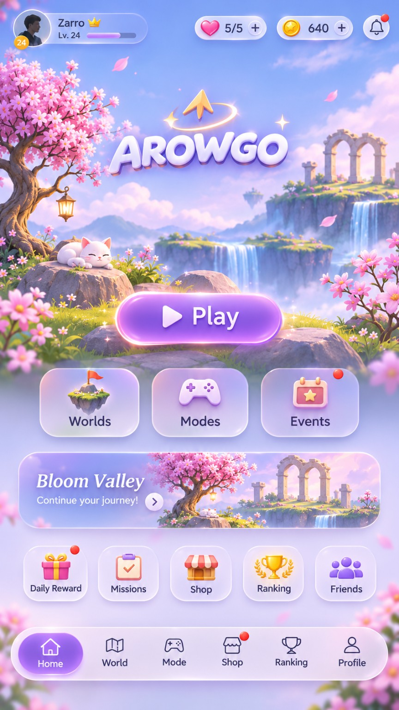
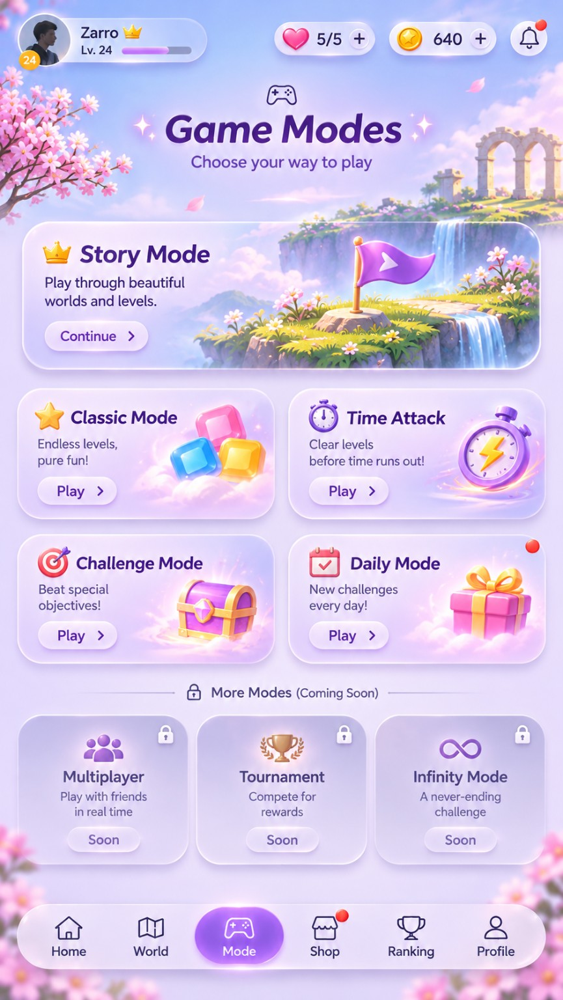
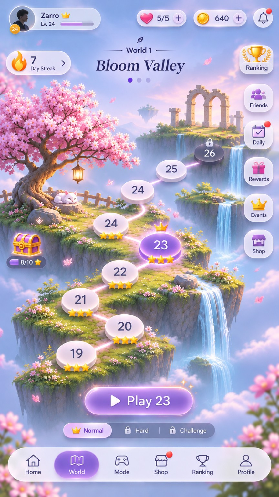
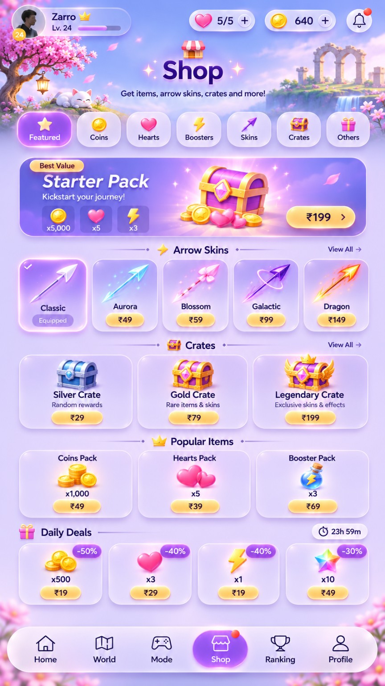
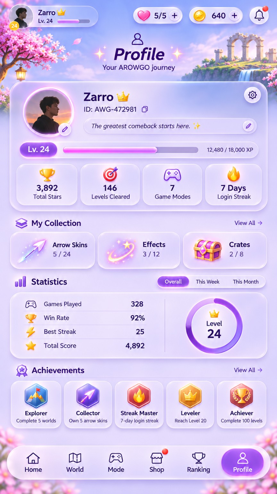
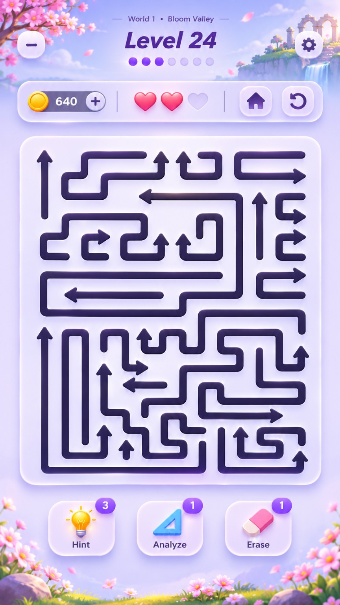

# AROWGO visual references

[Masterplan](../MASTERPLAN.md) · [Review](../docs/review-and-recommendations.md) · [Provenance and SHA-256 manifest](manifest.json)

All six images were supplied by the user and copied unchanged from temporary attachments. They are concept references, not production-ready layered assets, verified gameplay captures, real player data or approved prices. Creator, license and reuse rights are not established here. Keep UI text separate from final background art and record provenance before shipping assets.

## Screen review

| Reference | Preserve | Change / clarify before building |
| --- | --- | --- |
| 01 Home | Strong Play button, world banner, blossom/island setting | Remove global heart refill; reduce duplicate shortcuts and unavailable destinations; real notification badges only |
| 02 Modes | Story hero and clear visual mode hierarchy | Story/practice first; other cards deferred; Classic and Infinity need distinct rules |
| 03 World | Scenic progression path and selected-level emphasis | Duplicate 24 label; selection versus continuation unclear; align title/node/Play target and hide unavailable side actions |
| 04 Shop | Cosmetic preview cards and clear equipped state | INR prices are placeholders; paid crates, heart packs and deal timers excluded from MVP; no fabricated discount |
| 05 Profile | Identity, collection and achievements hierarchy | Derive all stats; 3,892 stars is inconsistent with 146 campaign clears at three stars each; define XP, mode count and time windows |
| 06 Gameplay | Large rounded board, dark bent paths and three tools | Still art cannot prove movement or solvability; test density, tap targets and small-screen legibility; explain progress dots; simplify redundant exits |

The reference set has no dedicated Results, Ranking, pause/failure, onboarding or settings screens. Design these plus tool confirmation, insufficient-charge, corrupt-save recovery and offline states before calling the UI complete. Ranking remains deferred; a local record view must say Personal Best.

## Art direction handoff

Use lavender/pink atmosphere, blossoms, waterfalls and floating islands around a quiet high-contrast board. Reuse the source starting color tokens, then measure readability on device. Keep primary glow for the main action/selection. Use live text for labels and counters; use restrained ambient particles and reduced-motion alternatives. Build screen layouts responsively rather than treating the portrait artwork as a single tappable image.

## Gallery
### REF-01 — Home

### REF-02 — Modes

### REF-03 — World

### REF-04 — Shop

### REF-05 — Profile

### REF-06 — Gameplay

