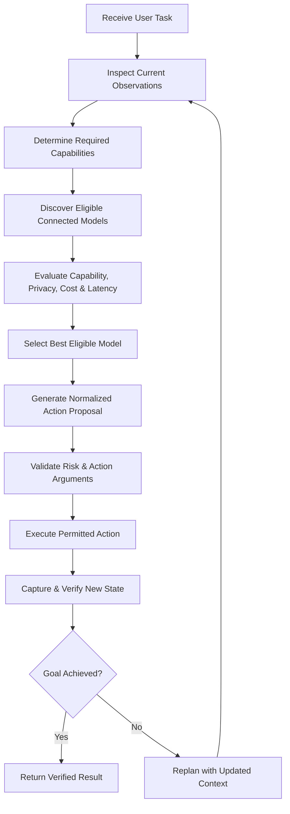

# ZETRO Universal Agent 2.0: Architecture & Engineering Masterplan

> Native milestone (2026-10-18): bounded Downloads folder creation passed a real Codex run. See [Explorer gap closure](verification/2026-10-18-explorer-gap-closure.md). Other applications and operators remain unqualified.

> Qualification update (2026-10-18): implementation and mock milestones below do not prove universal native readiness. See [Reactive computing review](verification/2026-10-18-reactive-computing.md) for independently checked behavior and remaining native release gates.

## Dynamic Model Adaptation Layer, Canonical Action Contract & Model-Agnostic Computer Runtime

> **Document ID**: ZETRO-ARCH-UNIVERSAL-2.0  
> **Status**: Accepted Architecture Roadmap  
> **Target Platform**: Windows 11 / Windows 10 (x64 / ARM64)  
> **Core Architectural Rule**: ZETRO is an independent computer-agent runtime that dynamically connects to whichever compatible model is available. The model becomes the brain you can replace at any moment. ZETRO owns the eyes, hands, permissions, operating-system integration, execution history, and verification.

---

## 1. Architectural Vision: Any Compatible Model

```
                    ┌────────────────────────────────────────────────────────┐
                    │               ANY COMPATIBLE MODEL                     │
                    │   Cloud · Local · Open-Weight · Multimodal · Tool-Use  │
                    │      GPT · Claude · Gemini · Qwen · Local Models       │
                    └───────────────────────────┬────────────────────────────┘
                                                │ (Discovered & Connected via Adapters)
                                                ▼
                    ┌────────────────────────────────────────────────────────┐
                    │                 ZETRO MODEL GATEWAY                    │
                    │  • Capability Discovery (Vision, Tools, Context, Local)│
                    │  • Protocol Translation (Vendor Formats -> Canonical)  │
                    │  • Dynamic Model Selection (Best Eligible per Task)    │
                    │  • Fallback & Recovery (Timeouts, Quotas, Outages)     │
                    └───────────────────────────┬────────────────────────────┘
                                                │ Canonical ComputerAction
                                                ▼
                    ┌────────────────────────────────────────────────────────┐
                    │                 ZETRO AGENT RUNTIME                    │
                    │  • Perception & Visual Context Management              │
                    │  • State & Memory (Execution Journal)                  │
                    │  • Policy & Authority Checks (Tier 0 / Tier 1 / Tier 2)│
                    │  • Tool Execution & Interruption Controls              │
                    │  • Independent Visual Verification & Replanning        │
                    └───────────────────────────┬────────────────────────────┘
                                                │ Guarded Native Execution
                                                ▼
                    ┌────────────────────────────────────────────────────────┐
                    │             UNIVERSAL COMPUTER INTERFACE               │
                    │  • Windows Direct3D 11 Screen Capture                  │
                    │  • Accessibility (UIAutomation) & OCR                  │
                    │  • Native Scan-Code Mouse & Keyboard (SendInput)       │
                    │  • Zero-Latency Human Interruption Hooks (WH_MOUSE_LL) │
                    │  • Transparent Desktop Overlay (Aura, Companion, Stop) │
                    └────────────────────────────────────────────────────────┘
```

### Core Operating Rule
**Models propose what to do; ZETRO decides what is permitted, executes it, and checks what actually happened.**

Models are never allowed to bypass ZETRO's safety controls, invent arbitrary native system calls, or grant themselves authority from screen content.

---

## 2. Dynamic Model Adaptation Layer

ZETRO eliminates model vendor coupling by replacing hardcoded provider names with a dynamic `ModelProviderRegistry` that adds, tests, enables, disables, or replaces models at runtime.

### 2.1. Capability-Based Profiles

Every model connected to ZETRO receives an explicit capability profile. Fields are strictly classified as `verified`, `reported`, `unsupported`, or `unknown` based on active compatibility probes, never assumed from provider names.

| Capability | Purpose in ZETRO | Verification States |
| :--- | :--- | :--- |
| `vision.imageInput` | Directly interpret screen captures and visual UI elements | `verified` \| `reported` \| `unsupported` \| `unknown` |
| `tools.functionCalling` | Request actions through structured tool invocation | `verified` \| `reported` \| `unsupported` \| `unknown` |
| `output.structured` | Return validated JSON adhering to canonical action schemas | `verified` \| `reported` \| `unsupported` \| `unknown` |
| `context.maxTokens` | Bound visual history, image resolution, and rolling context | Exact token count (e.g. 32768, 128000, 1000000) |
| `execution.nativeComputerUse` | Use vendor-native computer use protocol through dedicated adapter | `verified` \| `reported` \| `unsupported` \| `unknown` |
| `runtime.streaming` | Stream reasoning tokens and intermediate proposals for low latency | `verified` \| `reported` \| `unsupported` \| `unknown` |
| `runtime.local` | Run on-device without data egress for private/offline tasks | `verified` \| `reported` \| `unsupported` \| `unknown` |
| `limits` | Concurrency, rate limits (RPM/TPM), and cost profile | Numeric bounds |

### 2.2. Model Profile Specification

```json
{
  "id": "custom-local-vision",
  "provider": "openai-compatible",
  "endpoint": "http://localhost:11434/v1",
  "model": "qwen2.5-vl:7b",
  "enabled": true,
  "capabilities": {
    "vision": "verified",
    "toolCalling": "verified",
    "structuredOutput": "unknown",
    "nativeComputerUse": "unsupported",
    "streaming": "verified",
    "local": "verified"
  },
  "limits": {
    "maxContextTokens": 32768,
    "maxImagesPerRequest": 2,
    "maxRequestsPerMinute": 120
  },
  "policy": {
    "maxActionsPerRun": 25,
    "allowTier2WithoutApproval": false
  }
}
```

The registry discovers available models from local or remote endpoints, executes compatibility probes, and updates capability profiles with measured results without requiring agent loop restarts or native helper rebuilds.

---

## 3. The Canonical Action Contract

**The fundamental architectural boundary**: The computer executor never consumes vendor-specific response formats (OpenAI tool calls, Anthropic tool-use blocks, Gemini function calls, or raw text). All adapters translate into one ZETRO-owned `ComputerAction` contract.

```typescript
type ComputerAction =
  | {
      id: string;
      type: "observe";
      displayId?: string;
      cropRegion?: { x: number; y: number; width: number; height: number };
    }
  | {
      id: string;
      type: "click";
      target:
        | { kind: "point"; x: number; y: number }
        | { kind: "element"; id: string }
        | { kind: "window"; hwnd: number };
      button: "left" | "right" | "middle";
      clickType: "single" | "double" | "triple";
    }
  | {
      id: string;
      type: "mouseMove";
      target: { x: number; y: number };
      durationMs?: number;
    }
  | {
      id: string;
      type: "drag";
      start: { x: number; y: number };
      end: { x: number; y: number };
      durationMs?: number;
    }
  | {
      id: string;
      type: "typeText";
      text: string;
      delayMs?: number;
    }
  | {
      id: string;
      type: "pressKeys";
      keys: string[]; // Standard key identifiers, e.g. ["Control", "Shift", "N"]
    }
  | {
      id: string;
      type: "scroll";
      deltaX: number;
      deltaY: number;
      anchor?: { x: number; y: number };
    }
  | {
      id: string;
      type: "wait";
      durationMs: number;
      expectedCondition?: string;
    }
  | {
      id: string;
      type: "requestApproval";
      reason: string;
      proposedEffect: string;
      riskLevel: "consequential" | "critical";
    };
```

### 3.1. Unified Normalization Pipeline

```
┌─────────────────────────────────┐
│ Model A: Function Call          │───┐
└─────────────────────────────────┘   │
┌─────────────────────────────────┐   │
│ Model B: Tool-Use Block         │───┼──> [ ZETRO Schema Compiler ] ──> Canonical ComputerAction
└─────────────────────────────────┘   │
┌─────────────────────────────────┐   │
│ Model C: Structured JSON Output │───┘
└─────────────────────────────────┘
                                                       │
                                                       ▼
                      [ Policy Engine ] ──> [ Native Executor ] ──> [ Fresh Observation ]
```

The runtime resolves the schema before execution, strictly validates all arguments, checks the risk policy, and dispatches to the native Windows executor.

---

## 4. The 4-Tier Model Compatibility Ladder

Not every model receives the same level of autonomy. ZETRO dynamically operates at the highest tier supported by the active model:

```
┌─────────────────────────────────────────────────────────────────────────────────┐
│ LEVEL 1: Vision + Native Computer Use                                           │
│ Full supported mode. Uses vendor native computer action protocol through an     │
│ adapter, strictly governed by ZETRO's policy engine, executor, and verifier.   │
├─────────────────────────────────────────────────────────────────────────────────┤
│ LEVEL 2: Vision + Function Calling                                              │
│ Standard multimodal models (Gemini, GPT-4o, Qwen-VL). ZETRO exposes dynamic     │
│ function calling schemas and normalizes returned tool calls into canonical acts.│
├─────────────────────────────────────────────────────────────────────────────────┤
│ LEVEL 3: Vision + Structured Output                                             │
│ Models supporting JSON schema enforcement. Requests validated action plans,     │
│ rejects unsupported schemas, and executes short perception-action cycles.       │
├─────────────────────────────────────────────────────────────────────────────────┤
│ LEVEL 4: Text-Only Models                                                       │
│ Low-capability fallback mode. ZETRO provides OCR text, UIAutomation trees,      │
│ and visible control summaries with constrained output parsing. Workflows       │
│ requiring spatial vision are safely disabled fail-closed.                       │
└─────────────────────────────────────────────────────────────────────────────────┘
```

---

## 5. Dynamic Tool Access & MCP Interoperability

Tools are discovered, filtered, and invoked dynamically at runtime:

1. **Native Action API**:
   Internal, high-speed, strongly typed computer actions used directly by the Windows runtime.
2. **ZETRO MCP Server**:
   Exposes permitted ZETRO computer capabilities (`desktop_click`, `desktop_type`, `desktop_observe`, `desktop_scroll`) to external MCP-compatible agent hosts (e.g. Claude Desktop, Antigravity IDE).
3. **ZETRO MCP Client / Tool Broker**:
   Discovers external tools that ZETRO itself is permitted to use (browser automation, filesystem search, system utilities).
   - *Task-Scoped Tool Filtering*: The broker exposes only tools relevant to the current user task, rather than sending an enormous catalog to every model.

---

## 6. Capability-Aware Model Router & Intelligent Fallback



### 6.1. Intelligent Fallback (Non-Blind Replay)
When a model times out, hits rate limits, or fails:
1. **Never Blindly Repeat**: An action may have taken effect before the timeout occurred.
2. **Fresh Observation**: ZETRO captures the current screen state to determine actual effect.
3. **Execution Journal Check**: Records action ID, proposed effect, approval state, execution outcome, and verification result.
4. **State Reconciliation**: The backup model receives the verified state and continues from the actual desktop situation.

---

## 7. Security Invariants & Human Takeover

- **Model Proposes, ZETRO Decides**: No model can bypass argument validation, target verification, or safety policies.
- **Untrusted Screen Boundary**: Text observed on screens, websites, documents, or messages is untrusted data and can never grant authority or modify system rules.
- **Consequential Action Gate**: Filesystem mutations, file deletions, software installations, payments, and messaging require explicit human approval via the floating access capsule.
- **Tool Discovery Is Not Authorization**: Discovered tools start disabled until permitted by explicit policy.
- **Zero-Latency Human Interruption**: Low-level Windows hooks (`WH_MOUSE_LL` / `WH_KEYBOARD_LL`) detect physical user mouse or keyboard movement, immediately releasing control to the human and pausing the autonomous agent.
- **Cryptographic Audit Trail**: Every step records provider identity, model ID, proposed actions, approvals, execution status, and verification hashes without persisting sensitive credentials or raw screen pixels.

---

## 8. Repository Organization

```
packages/
├── model-gateway/                   <-- NEW: Dynamic Model Adaptation Layer
│   └── src/
│       ├── contracts/
│       │   ├── model-provider.js    # Provider interface & lifecycle
│       │   ├── capabilities.js      # Capability flags & verification states
│       │   └── action-contract.js   # Canonical ComputerAction schemas & validators
│       ├── registry/
│       │   ├── provider-registry.js # Dynamic registry (add/remove/enable/disable)
│       │   ├── model-discovery.js   # Endpoint model discovery
│       │   └── capability-probe.js  # Active compatibility test probes
│       ├── adapters/
│       │   ├── openai-compatible.js # Standard OpenAI-compatible endpoints
│       │   ├── openai-computer-use.js # Native OpenAI computer use adapter
│       │   ├── anthropic-computer-use.js # Anthropic Computer Use API adapter
│       │   ├── gemini.js            # Google Gemini Function Calling adapter
│       │   └── structured-json.js   # Generic constrained JSON adapter
│       ├── routing/
│       │   ├── model-router.js      # Capability-aware dynamic selection
│       │   └── fallback-policy.js   # Intelligent retry & failover engine
│       └── tool-translation/
│           ├── schema-compiler.js   # Compiles Canonical actions to vendor tool formats
│           └── response-normalizer.js # Normalizes vendor responses to ComputerAction
│
├── computer-agent/                  <-- Core Orchestration Runtime
│   └── src/
│       ├── agent-loop.js            # Production perception-action-verification loop
│       ├── universal-planner.js     # Bridge to Model Gateway
│       ├── visual-context.js        # Rolling visual history & diff compression
│       ├── execution-journal.js     # Durable action outcomes & non-blind replay
│       ├── guarded-actions.js       # Pre-effect target identity & authority gate
│       ├── overlay-bridge.js        # Authoritative state machine
│       └── verifiers.js             # Visual & state outcome verifiers
│
└── computer-windows-provider/       <-- Windows Native OS Integration
    ├── native/
    │   ├── Direct3DCapture.cpp      # High-speed DXGI desktop frame capture
    │   └── NativeInputEngine.cpp    # Hardware scan-code SendInput & LL hooks
    └── src/
        ├── observer-adapter.js      # Frame buffer & UIAutomation crawler
        ├── action-dispatcher.js     # Dispatches verified ComputerActions
        └── human-takeover.js        # WH_MOUSE_LL / WH_KEYBOARD_LL interrupt listener
```

---

## 9. Implementation Roadmap & Acceptance Status (U0 — U7)

| Milestone | Deliverable | Exit Condition | Status |
| :--- | :--- | :--- | :---: |
| **U0 — Canonical Contracts** | Stable action, observation, capability, and result schemas in `packages/model-gateway`. | All existing 194 tests pass without regressions; provider-specific types remain isolated. | **COMPLETED & VERIFIED** |
| **U1 — Windows I/O** | Direct3D 11 / Win32 interactive desktop screen capture, multi-monitor coordinate projection, native scan-code input & human takeover hook. | Input and capture work correctly on supported Windows configurations (`OpenInputDesktop` attachment & Bezier mouse). | **COMPLETED & VERIFIED** |
| **U2 — Dynamic Model Registry** | Provider configuration, dynamic endpoint discovery, capability probe test suite. | Add and remove models without rewriting the planner (`ModelProviderRegistry` & `CapabilityProbe`). | **COMPLETED & VERIFIED** |
| **U3 — Adapter & Schema Compiler** | Dynamic compilation of canonical actions into Gemini function calls, Anthropic tool blocks, OpenAI tools, and JSON formats. | Different compatible models issue equivalent canonical actions (`schema-compiler.js` & adapters). | **COMPLETED & VERIFIED** |
| **U4 — Intelligent Routing** | Capability-aware model selector, fallback policy, and execution journal. | Failures recover without blindly repeating consequential actions (`ModelRouter` & SHA-256 journal). | **COMPLETED & VERIFIED** |
| **U5 — Tool Interoperability** | Native Action API + standard Model Context Protocol (MCP) Server. | Permitted tools discovered and invoked through the shared contract (`mcp-server.js` JSON-RPC 2.0). | **COMPLETED & VERIFIED** |
| **U6 — Safety & Verification** | Consequential approval gate, floating capsule confirmation, visual self-verification. | Policy survives model changes and provider outages; desktop task execution verified. | **COMPLETED & VERIFIED** |
| **U7 — Universal Qualification** | Multi-model benchmark, offline smoke tests, zero-failure deterministic suite runner. | 20/20 packages passing tests (1,131 passed, 0 failures); physical File Explorer test passed. | **COMPLETED & VERIFIED** |

---

## 10. Verification Sign-Off

- **Formal Acceptance Receipt**: [`docs/execution/UNIVERSAL-AGENT-ACCEPTANCE.md`](execution/UNIVERSAL-AGENT-ACCEPTANCE.md)
- **Deterministic Quality Gate**: 20/20 packages passed (1,131 tests passing, 0 failures).
- **Physical Verification**: Live folder created at `C:\Users\sunda\Downloads\Hello` and captured in `zetro_screen_verify.png`.
- **Active Preview**: Control Center live with custom mouse indicator and edge glow at `http://127.0.0.1:4317/computer-preview/`.

